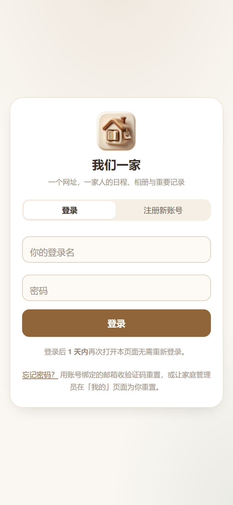
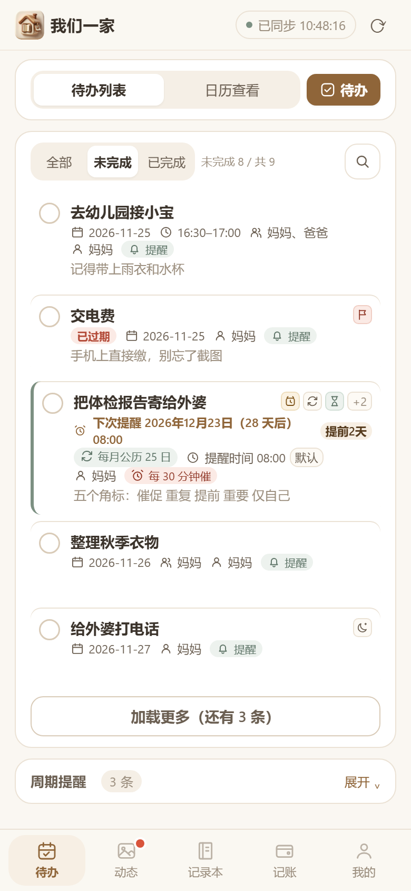
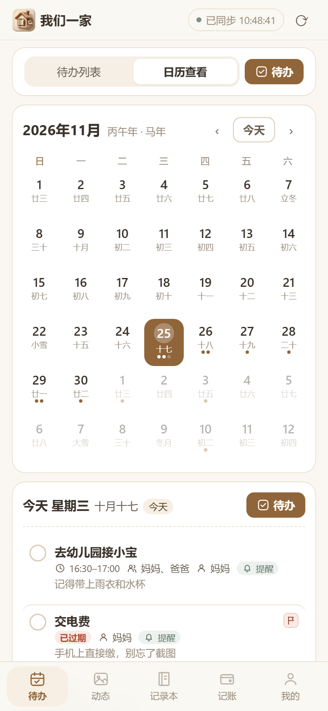
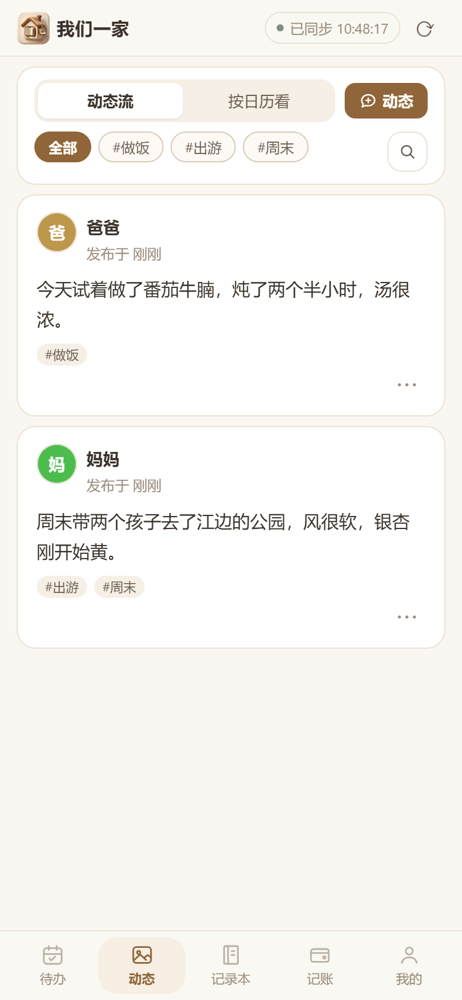
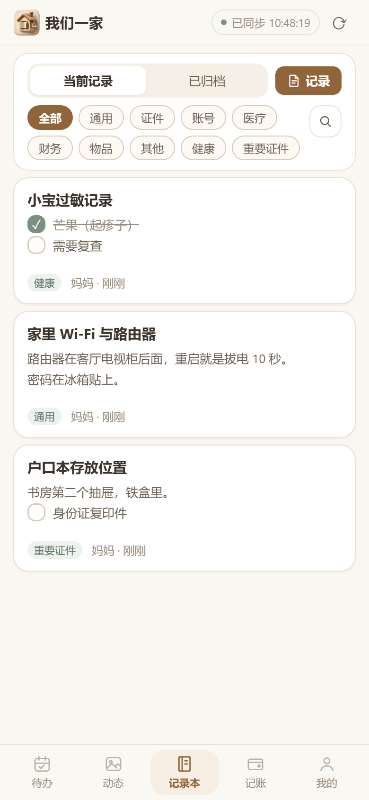
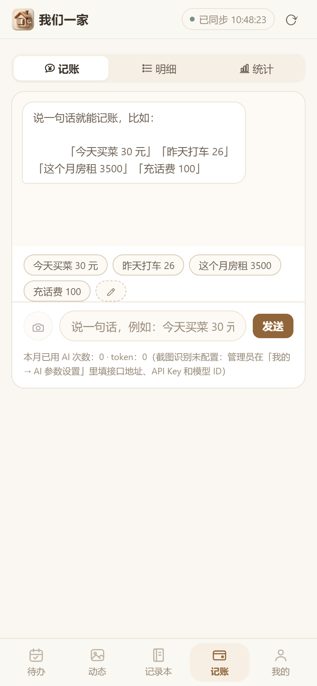
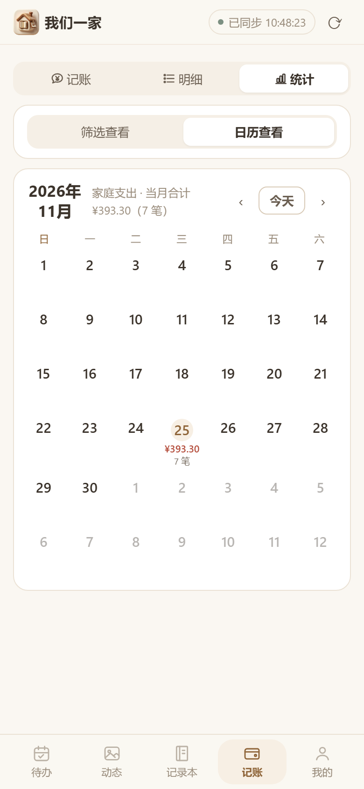
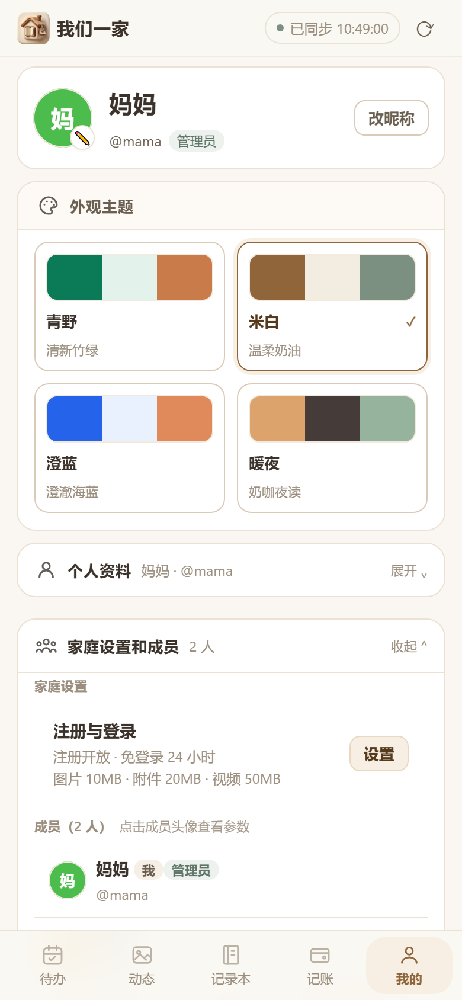
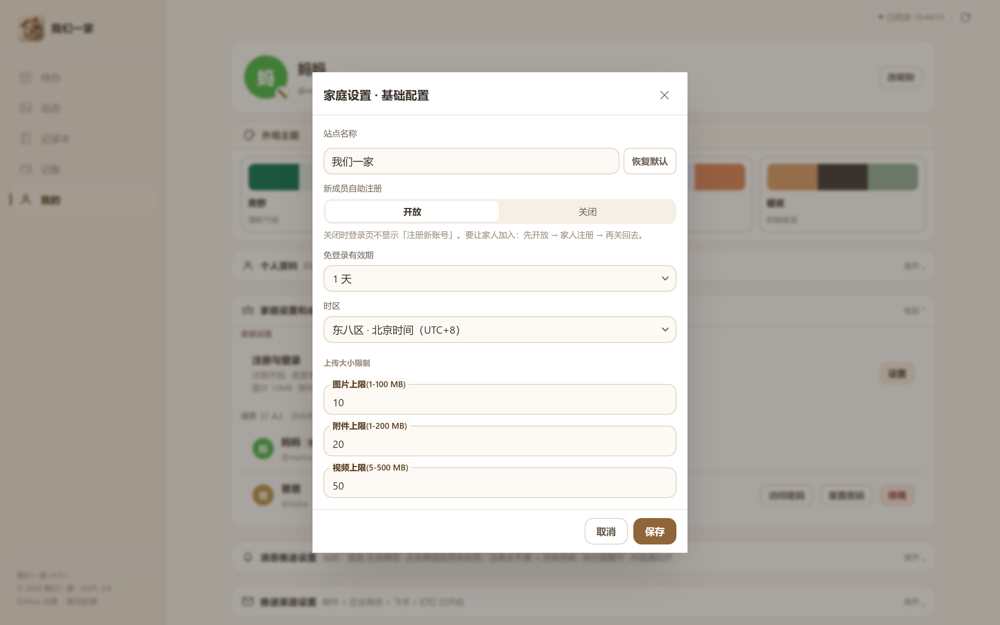

# 我们一家 · 家庭共享生活管家

> 装在自己家里的一体化生活协作工具：**待办、动态、记录本、记账**，全家一个空间，数据全在自己手里。

<p align="center">
  
</p>

<p align="center"><sub>第一个注册的人自动成为家庭管理员，其余家人在同一个地址注册即可加入。</sub></p>

---

## 这是什么

给 2–6 人的小家庭用的自托管应用。把每天最容易忘的四件事收在一处：

| 要做什么 | 发生了什么 | 要记住什么 | 花了多少钱 |
| --- | --- | --- | --- |
| 万年历待办，到点提醒 | 图文动态，家人评论 | 重点记录本，可上锁 | 一句话记账 |

- **数据自持**：一个 SQLite 文件 + 一个上传目录，不经过任何第三方服务器。
- **零依赖**：Node ≥ 22.5 直跑，不需要 `npm install`；也可以 Docker 一条命令上线。
- **多端自适应**：手机和桌面同一套界面，手机上可「添加到主屏幕」当 App 用。

---

## 三分钟跑起来

**Docker（推荐）**

```bash
mkdir -p data && sudo chown -R 1000:1000 data
docker compose up -d
```

**Node 直跑**

```bash
node server.js          # 默认 3455 端口，数据落在 ./data
```

**飞牛 NAS**：应用中心 → 手动安装 → 选 `familyhub-<版本>-fnos-<架构>.fpk`（x86 选 amd64，ARM 选 arm64）。装完从飞牛桌面的「我们一家」图标进入。

打开 `http://机器IP:3455`，注册第一个账号（自动成为管理员）就能用了。

> **想在外网用？** 用 frp / 内网穿透只映射飞牛 Web 的 443 就够，不需要再给 3455 单独开端口 —— fpk 的桌面图标走飞牛统一网关（`/app/familyhub/`），和桌面同源同端口。用 Docker / Node 部署的，见 [完全配置 · 反向代理与 HTTPS](docs/guides/02-完全配置.md#挂在反向代理的子路径下)。

---

## 第一次使用

1. **注册管理员** —— 登录页切「注册新账号」，第一个账号自动是管理员，同时系统会关闭自助注册。
2. **拉家人进来** —— 我的 → 家庭设置和成员 → 设置 → 「新成员自助注册」切到**开放**；家人注册完再关回去。
3. **建第一条待办 / 记第一笔账** —— 记账直接说人话：`今天买菜 30 元`。
4. **导出一次备份** —— 我的 → 数据备份。以后照着做就行。

> 只想到这一步？看 **[最少配置使用说明](docs/guides/01-最少配置.md)**，10 分钟能用，不配任何推送。

---

## 功能一览

### 待办

公历 + 农历 + 二十四节气 + 传统节日；周期提醒（每周 / 每月 / 每年，公历或农历）；参与人、提前提醒、催办；支持一句话快捷添加。

### 动态

朋友圈式时间流：文字 + 最多 9 图 / 3 段视频，家人可评论、可「一起写」共创；标签筛选、关键词搜索、按日历回看。视频用内置播放器，服务端支持 Range 分段，手机上边下边播。

### 记录本

证件、账号、病史、支出约定这类要长期留着的资料：自定义分类、附件上传、勾选清单、归档不丢；支持访问密码整体上锁。

### 记账

聊天式一句话记账（本地解析、断网可用）；拍小票由视觉模型识别，**确认后**才入库；个人 / 全家 × 日 / 月统计、分类排行、预算预警；CSV 导出。

---

## 界面一览

<p align="center"><sub>以下均为产品真实界面（本机 v5.0.1 实拍），手机端竖版 + 一张桌面端设置页。</sub></p>

<table>
  <tr>
    <td width="33%" align="center"><br /><sub>待办：筛选、搜索、分页与参与人</sub></td>
    <td width="33%" align="center"><br /><sub>万年历：圆点标记当日事项</sub></td>
    <td width="33%" align="center"><br /><sub>动态：发帖、搜索、标签合一</sub></td>
  </tr>
  <tr>
    <td align="center"><br /><sub>记录本：分类、锁、附件</sub></td>
    <td align="center"><br /><sub>记账：一句话输入与快捷短语</sub></td>
    <td align="center"><br /><sub>统计：日 / 月、个人 / 全家</sub></td>
  </tr>
  <tr>
    <td align="center"><br /><sub>主题：青野 / 米白 / 澄蓝 / 暖夜</sub></td>
    <td colspan="2" align="center"><br /><sub>家庭设置（桌面端）：站点名称、注册开关、时区与上传上限</sub></td>
  </tr>
</table>

---

## 配置

两条路线，按需选：

| 路线 | 适合 | 文档 |
| --- | --- | --- |
| **最少配置** | 只想让全家用起来，不要推送 | [最少配置使用说明](docs/guides/01-最少配置.md) |
| **完全配置** | 要推送、要 AI 识别、要反代与备份体系 | [完全配置使用说明](docs/guides/02-完全配置.md) |

### 分步教程

| 教程 | 解决什么 |
| --- | --- |
| [① 邮件推送配置（QQ 邮箱）](docs/tutorials/01-邮件推送配置-QQ邮箱.md) | 待办提醒发到家人邮箱。配置量最小，也是其它通道的兜底 |
| [② 企业微信推送配置](docs/tutorials/02-企业微信推送配置.md) | 微信里收提醒、发一句「今天买菜 30 元」直接记账 |
| [③ 企业微信消息代理](docs/tutorials/03-企业微信消息代理.md) | 家宽动态 IP 导致企微报 `60020` 时的固定出口方案 |
| [④ 钉钉与飞书推送配置](docs/tutorials/04-钉钉与飞书推送配置.md) | 提醒发到家庭群，一个 Webhook 搞定 |
| [⑤ AI 接入（千问）](docs/tutorials/05-AI接入-千问.md) | 拍小票自动识别金额与分类 |

代理方案附可直接部署的完整代码：[`docs/tutorials/tools/wecom-relay.js`](docs/tutorials/tools/wecom-relay.js)（约 130 行，只用 Node 内置模块）。

> 教程配图都是本机实际运行后截的真实界面；第三方平台后台（QQ 邮箱、企业微信、钉钉、飞书、阿里云百炼）改版频繁，因此只给按钮级文字说明 + 官方入口，不画示意图。

**两条通用提醒**

- 推送分两层：管理员配「怎么发」，每位家人还要在「我的 → 消息推送设置」里配「发给谁」，否则只有管理员收得到。
- 配完别只看提示，到「推送日志」看真实投递结果与失败原因。

---

## 数据与备份

- 数据都在启动目录的 `data/`：`family.db` + `uploads/`。
- 备份：**我的 → 数据备份 → 导出备份**，或停服务后整目录拷贝。
- 恢复：同页面上传备份文件，或把 `data/` 换回去再启动。
- 升级：换镜像 / fpk 后重启即可，**老库启动时自动补列**，不需要手工迁移。

---

## 常见问题

**Q：家人收不到提醒？**
先看「我的 → 消息推送设置 → 推送日志」。多数情况是那位家人没填收件邮箱，或推送方式没选对。

**Q：注册入口不见了？**
第一个管理员建成后注册会自动关闭（防止陌生人进来）。管理员在家庭设置里重新开放即可。

**Q：忘记密码怎么办？**
账号绑了邮箱且家庭配了 SMTP 时，登录页「忘记密码？」可自助重置；否则请管理员在「家庭成员」里重置。

**Q：能在手机上装成 App 吗？**
能。iOS Safari「添加到主屏幕」、Android Chrome「安装应用」都支持。局域网 HTTP 也能装，只是不支持离线打开。

---

## 已知限制

- **视频不转码**：`moov` 在文件尾的 MP4 要整段下载才能播（可用 `ffmpeg -movflags +faststart` 重排）；HEVC 等格式依赖设备解码能力。
- **PWA 无离线缓存**：Service Worker 需要 HTTPS，默认内网 HTTP 部署下不启用；挂上证书后可再加。
- **忘记密码有两个前提**：账号绑了邮箱 + 家庭配了 SMTP，缺一不可。

---

## 版本与许可

当前版本 **5.0.7**。许可见 [LICENSE](LICENSE)（AGPL-3.0）。
