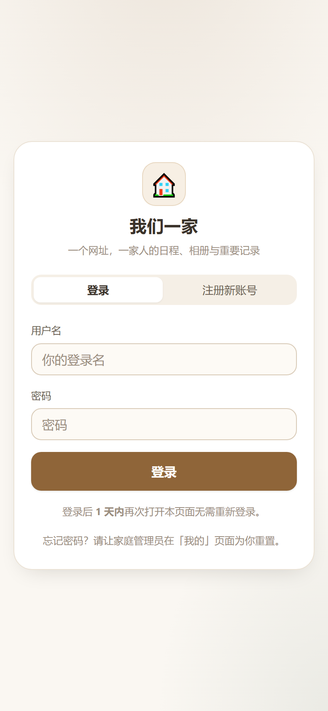
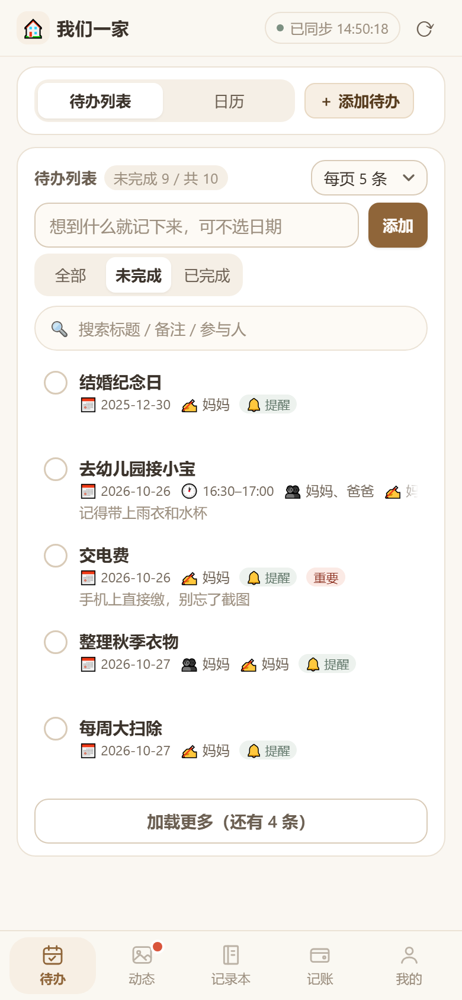
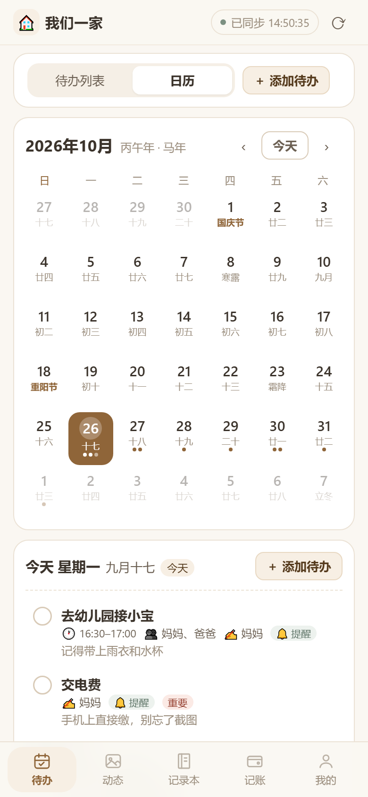
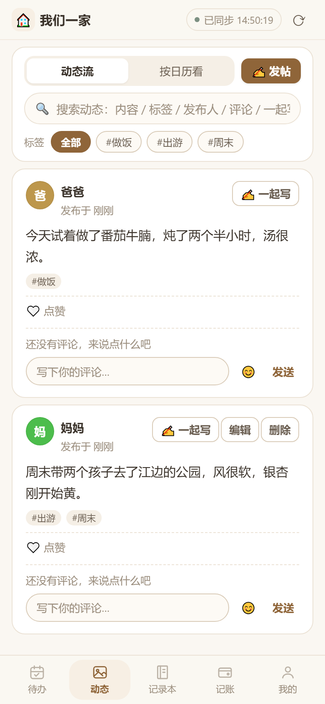
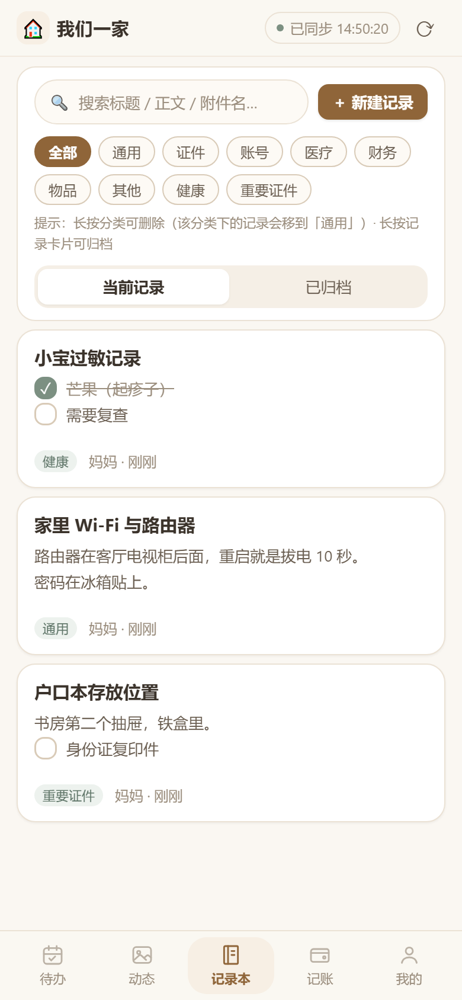
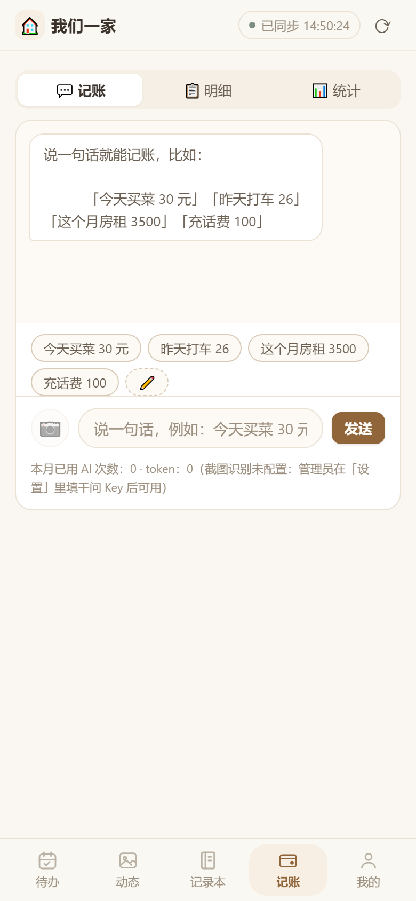
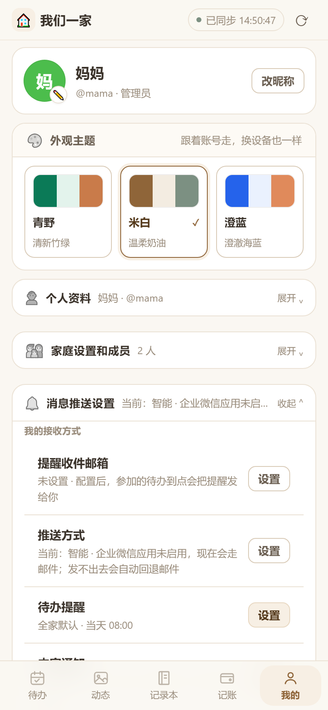
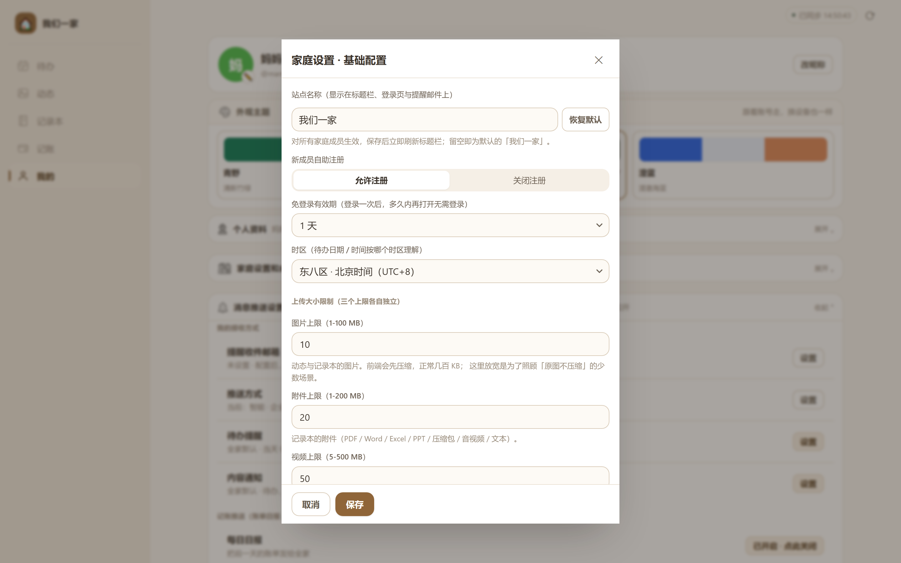

最前言：本人代码水平一般（几乎没有），项目完全由AI完成，经历几十个版本迭代才有了现在这个版本，基本能用，如果有什么问题或者好的建议，欢迎提出！
# 我们一家 · 家庭共享生活管家

> 一个面向小家庭的轻量一体化生活协作工具：待办、动态、记录本、记账，全家在一个空间里协同。

  

开箱即用的登录页——第一个注册者自动成为家庭管理员，其余成员自助加入。

---

## 一、产品定位

**我们一家** 是为 2–6 人小家庭设计的「自托管」生活协作中心。它把家庭日常最容易被遗忘、最容易各说各的四件事——**要做什么、发生了什么、要记住什么、花了多少钱**——收敛到一个私有部署的网页应用里，全家实时同步、各端自适应。

| 维度 | 说明 |
| --- | --- |
| 目标用户 | 小家庭 / 合住亲友（家庭共担事务的场景） |
| 核心场景 | 家庭待办提醒、家庭相册式动态、重要信息存档、共同记账 |
| 部署方式 | 私有部署（Docker 或 Node 直跑），数据完全自持 |
| 技术基调 | 零外部依赖、SQLite 单文件、原生前端，轻量可长期运行 |

---

## 二、核心功能

### 1. 万年历待办

农历、二十四节气与传统节日一目了然；待办默认只看「未完成」，进入即见今天还要做什么。支持**一句话快捷添加**、按日期建单、按参与人提醒，并内置「每周 / 每月 / 每年」周期提醒。

- 公历 + 农历 + 二十四节气 + 传统节日
- 周期提醒（每周 / 每月 / 每年公历或农历），不参与完成态
- 邮件提醒 + 提前 N 天提醒，按家庭时区精准计算
- 多人协同：任一成员增改，其他人自动同步

### 2. 图文动态 · 家庭朋友圈

一条朋友圈式的时间流，文字 + 多图（或视频），家人可评论、可「一起写」共创。支持标签筛选、关键词搜索、按日历回看。

- 文字 + 最多 9 图 / 3 段视频，视频自动取首帧封面
- 家人共创「一起写」、评论全部展示
- 图片支持双指缩放、左右滑动切换

### 3. 重点事项记录本

长期保存家庭重要信息：证件存放、账号备忘、病史、支出约定……可上锁、可归档、可带附件与勾选清单。

- 自定义分类（证件 / 账号 / 医疗 / 财务…），长按归档不丢失
- 访问密码（登录密码可作备用钥匙）
- 附件上传（单文件 20MB，可执行文件按文件头拦截）

### 4. 家庭记账

聊天式「一句话记账」：`今天买菜 30 元` 即入账，完全本地解析、断网可用。也能拍小票截图，由视觉模型识别后**确认再入库**。

- 一句话本地解析（金额 / 收支 / 日期 / 分类 / 备注）
- 千问截图记账：识别结果确认后才入库，密钥仅存服务端
- 个人 / 全家 × 日 / 月 四种统计、分类排行、预算预警
- CSV 导出（UTF-8 BOM，Excel 直接打开不乱码）

### 5. 家庭成员与管理

管理员在「家庭设置」里统一配置站点名称、注册开关、时区、待办提醒、内容通知、发件邮箱等；每位成员可自定义自己的收件邮箱与通知偏好。

- 自助注册开关、免登录有效期、站点名称自定义
- 待办邮件提醒与内容变更通知独立配置
- 一键导出 / 恢复备份，成员密码可重置

### 6. 个性化主题

内置青野、米白、澄蓝三套配色主题，移动端与桌面端一致呈现，照顾不同家庭成员的视觉偏好。

---

## 三、界面一览

下表为产品真实界面截图：手机端竖版按三列排布，右下为桌面端设置页。

<table>
  <tr>
    <td width="33%" align="center" valign="middle">
       
      待办列表：筛选、搜索、分页与参与人指定
    </td>
    <td width="33%" align="center" valign="middle">
       
      万年历：日历格用圆点标记当日事项
    </td>
    <td width="33%" align="center" valign="middle">
       
      家庭动态：发帖、搜索、标签筛选合一
    </td>
  </tr>
  <tr>
    <td align="center" valign="middle">
       
      记录本：分类、访问密码、附件与勾选清单
    </td>
    <td align="center" valign="middle">
       
      一句话记账：聊天式输入与快捷短语
    </td>
    <td align="center" valign="middle">
       
      记账统计：个人 / 全家 × 日 / 月 与分类排行
    </td>
  </tr>
  <tr>
    <td align="center" valign="middle">
       
      主题选择：一键切换并实时预览
    </td>
    <td colspan="2" align="center" valign="middle">
       
      家庭设置（桌面端）：基础 / 待办提醒 / 内容通知 / 发件邮箱 / 运行状态
    </td>
  </tr>
</table>

---

## 四、主要优势

**全家实时协同**
任一成员新增或修改，其他人的列表与日历自动同步；版块红点提示「别人更新过」。

**数据自持 · 隐私优先**
私有部署，SQLite 单文件存储，备份一键导出 / 恢复；记录本可单独上锁，仅自己可见的内容绝不外发。

**零依赖 · 轻量易部署**
无需 `npm install`，Node ≥ 22.5 自带 SQLite；Docker Compose 一条命令即可上线，长期运行资源占用低。

**多端自适应**
同一套界面在手机与桌面自动重排，输入框始终在键盘上方，移动场景不打断输入。

**提醒与通知可靠**
待办邮件提醒 + 内容变更通知双轨独立；支持提前提醒、汇总发送、免打扰时段，并有「运行状态」页可核查是否生效。

**记账省心**
一句话本地记账零延迟、零额度消耗；截图记账识别确认后入库，密钥不出服务端；月度 AI 额度可设上限熔断。

**模板可配置**
待办提醒、内容通知、记账推送的邮件模板均可自定义并一键恢复默认，文案随家庭习惯调整。

---

## 五、部署与获取

- **Docker（推荐）**：`docker compose up -d`，挂载 `./data` 持久化
- **Node 直跑**：环境要求 Node.js ≥ 22.5，启动即服务，无需安装依赖
- **离线镜像包**：提供飞牛应用中心 `.fpk` 离线安装包，适用于无外网环境

> 本文档配图均为产品真实界面截图，基于 **v4.21.0** 编写。
