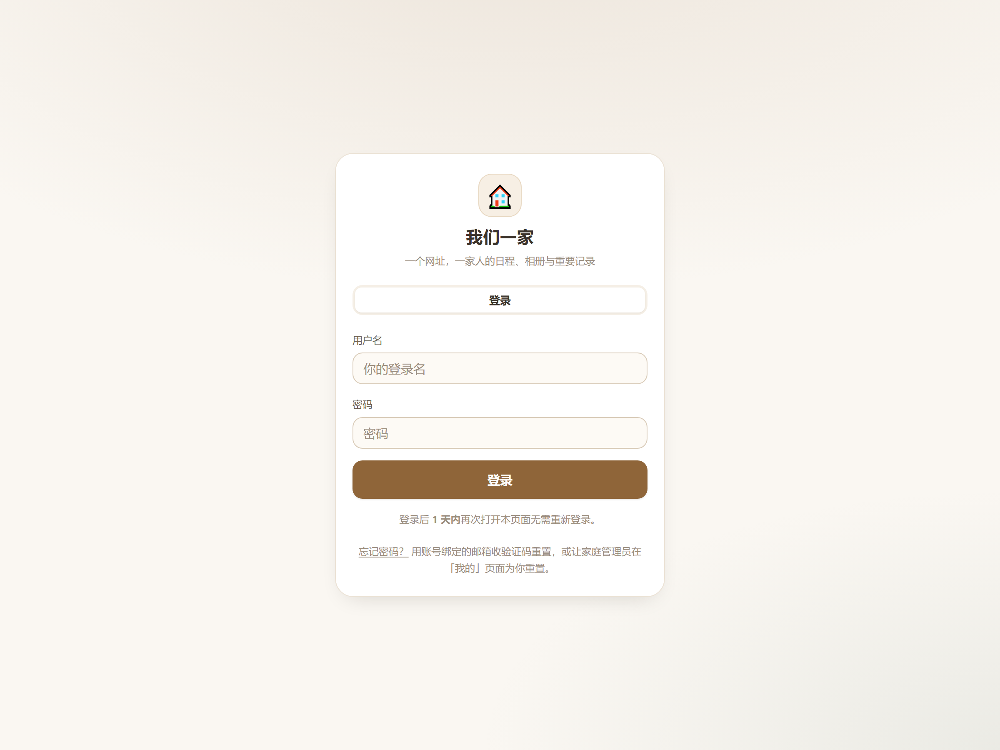
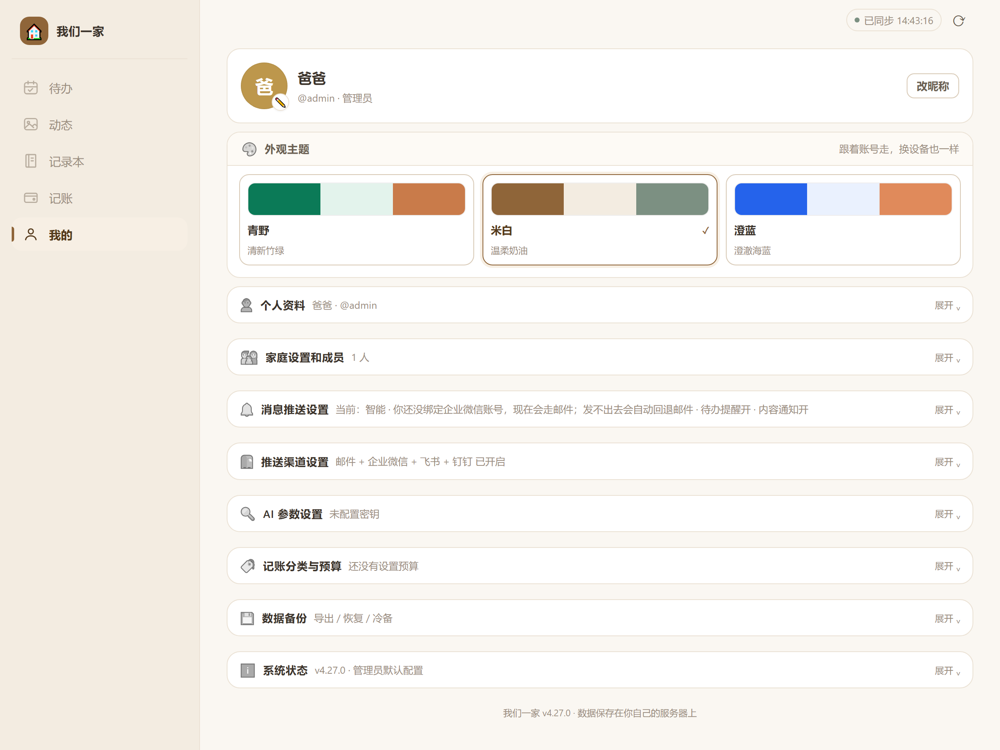
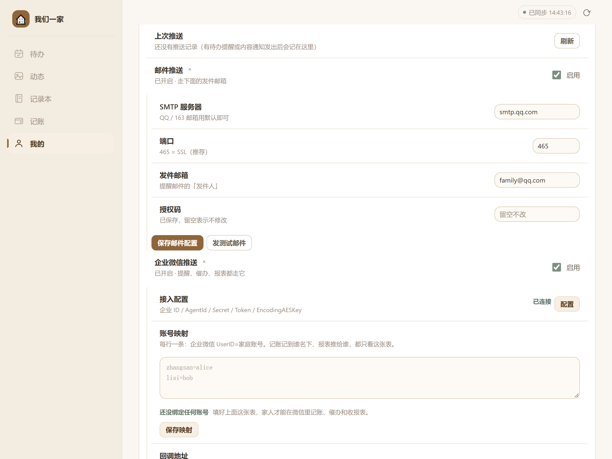
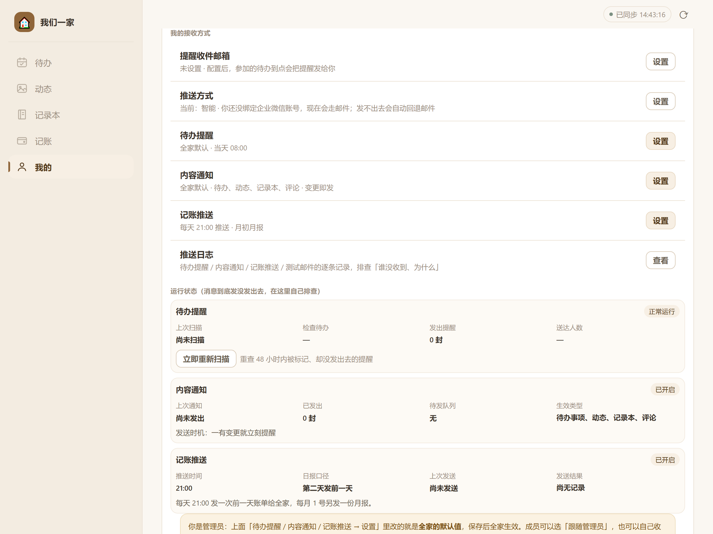
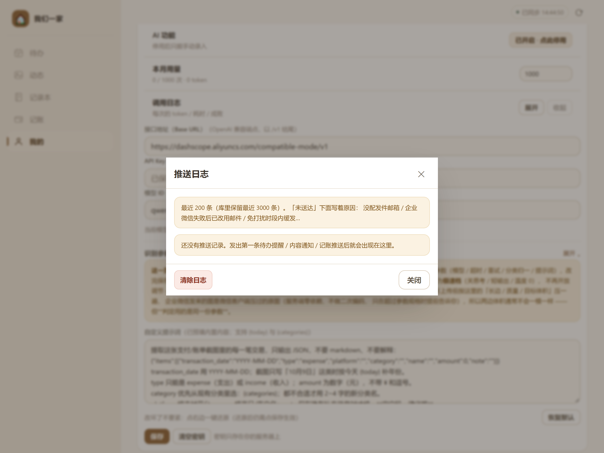

# 教程① 邮件推送配置（以 QQ 邮箱为例）

> 耗时约 10 分钟，难度低。
> 一句话：管理员配一个「发件邮箱」，每位家人填自己的「收件邮箱」，待办提醒、内容通知、记账报表就会发到邮箱。

邮件是门槛最低的通道：不用企业认证、不用公网地址、不用装 App，也是其它通道出问题时的兜底。

配置分两层，别混：

| 层级 | 谁配 | 在哪 | 作用 |
| --- | --- | --- | --- |
| 发件方（SMTP） | 管理员，全站一份 | 我的 → 推送渠道设置 → 邮件推送 | 邮件从哪个邮箱发出 |
| 收件方 | 每位家人各自 | 我的 → 消息推送设置 → 收件邮箱 | 提醒发到谁的信箱 |

---

## 前置准备

1. **管理员账号**。「推送渠道设置」只对管理员可见。
2. **一个能开 SMTP 的邮箱**。推荐 QQ 邮箱（免费、限制宽松）；163 用 `smtp.163.com`，腾讯企业邮用 `smtp.exmail.qq.com`。
3. **服务器能出网**：跑应用的机器要能访问 `smtp.qq.com:465`。

---

## 第 1 步：拿 QQ 邮箱的 16 位授权码

> 在 QQ 邮箱网页版操作，不在本应用里。官方帮助：<https://help.mail.qq.com/detail/0/1087>

1. 打开 <https://mail.qq.com> 登录要用来发信的邮箱。
2. 顶部 **设置 → 账号与安全**。
3. 找到 **「POP3/IMAP/SMTP/Exchange/CardDAV/CalDAV 服务」**，点对应服务的 **开启**。
4. 按提示用绑定手机发短信验证，回来后点 **我已发送**。
5. 页面弹出 **16 位授权码**，立刻复制保存（只完整显示一次）。

两个最容易错的地方：

- **授权码不是登录密码**，填的是那 16 位字符。
- **改过 QQ 密码，授权码立即失效**，需要重新生成。

---

## 第 2 步：在应用里填发件邮箱

用管理员登录后，走：**我的 → 推送渠道设置 → 邮件推送**。

*📷 图 1：登录页。只有管理员能看到「推送渠道设置」。图源：本机 v5.0.0 实拍（演示数据）。*

*📷 图 2：「我的」页里的推送渠道设置，右侧摘要直接给出四个通道的开关状态。图源：本机 v5.0.0 实拍。*

*📷 图 3：邮件配置区四个字段（演示值 `smtp.qq.com` / `465` / `family@qq.com`）。图源：本机 v5.0.0 实拍。*

| 字段 | 填什么 |
| --- | --- |
| SMTP 服务器 | `smtp.qq.com`（不用改） |
| 端口 | `465`（SSL 直连，最省事） |
| 发件邮箱 | 完整地址，含 `@qq.com` |
| 授权码 | 第 1 步那 16 位，不要带空格 |

点 **保存邮件配置**。保存后授权码框永远为空、显示「留空表示不修改」——这是不回显密码，改其它三项时不用重填。

---

## 第 3 步：发一封测试邮件

同一区块点 **发测试消息**。

- 成功：右上角绿色提示，说明 SMTP 通、授权码对。
- 失败：红色提示带服务端原始错误（如 `SMTP 535`），对照下面排查表。

> 测试邮件发给当前管理员自己的收件邮箱；没填过会提示先填，所以第 4 步可以提前做。

---

## 第 4 步：让每位家人填收件邮箱

发件邮箱是全家一份，**收件人是个人的**。

路径：**我的 → 消息推送设置 → 收件邮箱 → 设置**。

*📷 图 4：「我的接收方式」区块，收件邮箱为空就点右侧「设置」；下面的推送方式与三类通知都是每人独立。图源：本机 v5.0.0 实拍。*

| 设置项 | 默认 | 说明 |
| --- | --- | --- |
| 收件邮箱 | 空 | 必须填，否则这个人收不到任何邮件 |
| 推送方式 | 智能 | 绑了企微走微信，没绑走邮件 |
| 待办提醒 | 跟随全家（当天 08:00） | 可单独改时间或关掉 |
| 内容通知 | 跟随全家（变更即发） | 动态、记录本、评论的变动 |
| 记账推送 | 跟随全家（每天 21:00 日报，每月 1 号月报） | 记账报表 |

---

## 排查

| 现象 | 原因 | 怎么办 |
| --- | --- | --- |
| `SMTP 535 authentication failed` | 填了 QQ 登录密码，或授权码已失效 | 重新生成授权码再保存 |
| `connect ETIMEDOUT` | 服务器出网被拦（安全组 / 公司网络 / NAS 防火墙） | 放行出站 465，用 `nc -vz smtp.qq.com 465` 验证 |
| 「该端口需要 STARTTLS 但服务器不支持」 | 端口填了 25 / 587 且链路破坏 TLS | 改成 **465** |
| 「发件邮箱或授权码未配置」 | 四项没填全 | 填全后重新保存 |
| 保存成功但家人收不到 | 那人没填收件邮箱，或关掉了待办提醒 | 让对方进「消息推送设置」检查 |
| 邮件进了垃圾箱 | 发件域名与家庭宽带出口 IP 不匹配 | 让对方把发件地址加入白名单 |
| 忘记密码提示「服务器未配置发件邮箱」 | 该功能共用同一套 SMTP | 先配好本节 |

排查顺序：**发测试邮件**（验全局）→ 看报错 → 成功则查个人配置 → 看推送日志。

*📷 图 5：推送日志弹窗。库里保留最近 3000 条、界面显示最近 200 条，「未送达」会写明原因。图源：本机 v5.0.0 实拍（演示库为空）。*

---

## 验收清单

- [ ] QQ 邮箱已开 SMTP，拿到并保存了 16 位授权码
- [ ] 四项已填、开关已勾选、保存成功
- [ ] 「发测试消息」成功，邮箱里确实收到
- [ ] 每位家人都填了收件邮箱
- [ ] 造一条 5 分钟后的待办，到点能收到，且推送日志里有记录
