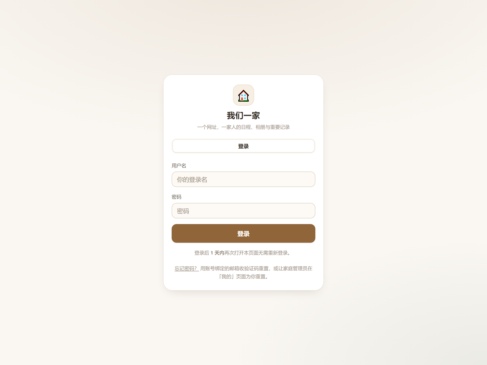
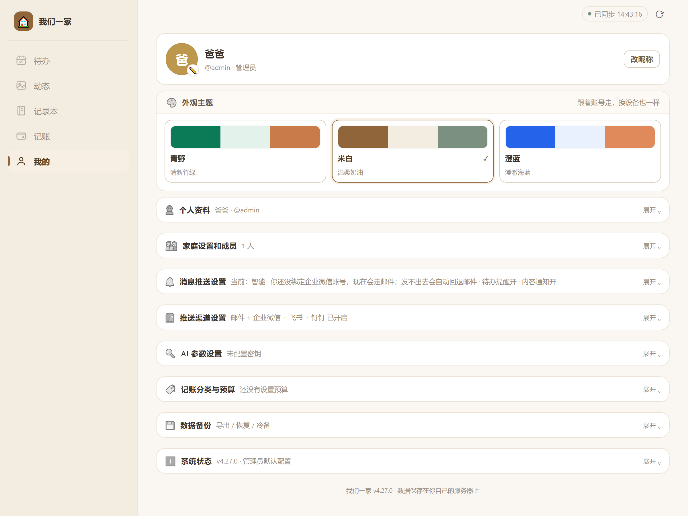
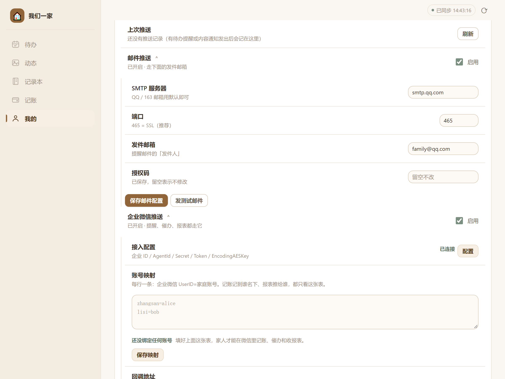
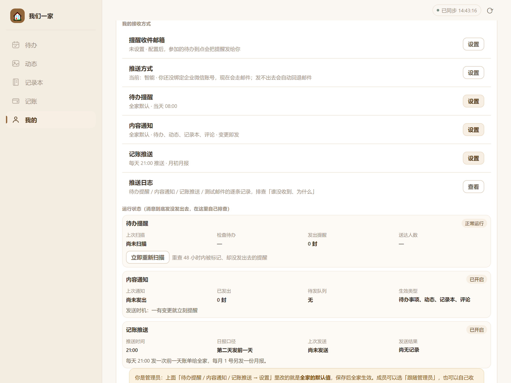
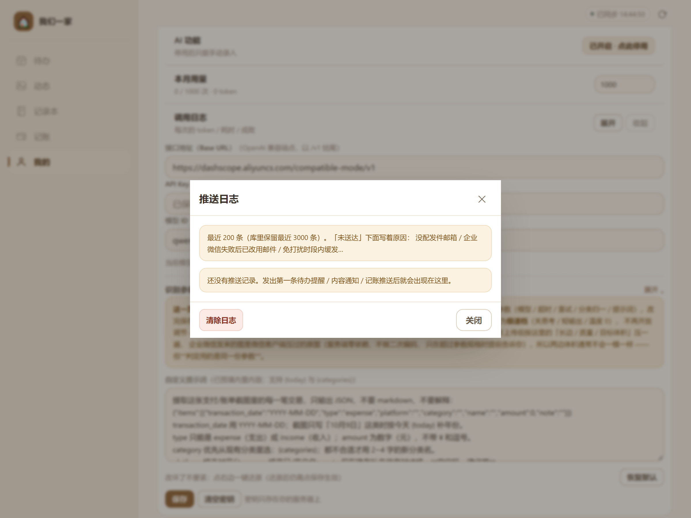

# 教程① 邮件推送配置（以 QQ 邮箱为例）

> 适用版本：**v4.27.0**　｜　预计耗时：10 分钟　｜　难度：简单  
> 一句话：管理员配一个「发件邮箱」，每位家人填自己的「收件邮箱」，此后待办提醒、内容通知、记账报表都会通过邮件发出。

---

## 一、这份教程解决什么问题

「我们一家」的所有推送都是**服务端主动发出去**的。邮件是其中门槛最低的一条通道：不需要企业认证、不需要公网回调、不需要装 App，只要有邮箱就能收。

它还是**兜底通道**：当某位家人选了「智能」推送方式、但还没绑定企业微信时，系统会自动走邮件；企微发送失败时也会回落到邮件。所以哪怕你后面要用企业微信或群机器人，也建议把邮件配好。

配置分两层，别混在一起：

| 层级            | 谁配       | 在哪配                  | 作用             |
| ------------- | -------- | -------------------- | -------------- |
| **发件方**（SMTP） | 管理员，全站一份 | 我的 → 推送渠道设置 → 邮件推送   | 决定「邮件从哪个邮箱发出去」 |
| **收件方**       | 每位家人各自填  | 我的 → 消息推送设置 → 提醒收件邮箱 | 决定「提醒发到谁的邮箱」   |

---

## 二、关于本文截图

| 截图类型                    | 来源                                   | 说明                                                                |
| ----------------------- | ------------------------------------ | ----------------------------------------------------------------- |
| **本项目界面图**（图 1、图 2、图 3） | 在本机运行 v4.27.0 真实服务、用 Chrome 实际点击界面截取 | 截图里的邮箱 `family@qq.com`、域名 `127.0.0.1` 都是**演示用的占位数据**，不是任何人的真实配置   |
| **QQ 邮箱后台界面**           | **不提供截图**                            | 腾讯的界面会随版本改版，这里贴图容易过时甚至误导。本文用「精确到按钮名」的文字步骤 + 官方帮助链接代替，请以你实际看到的界面为准 |

各步骤的官方入口在对应小节里给出，均为腾讯官方帮助页。

---

## 三、前置准备

1. **一个管理员账号**。「推送渠道设置」只对管理员可见（图 1 里 `@admin · 管理员` 那一行就是这个身份）。
2. **一个能开启 SMTP 服务的邮箱**。推荐 QQ 邮箱：免费、限制宽松、授权码流程成熟。
   - 163 / 126 邮箱也可以用，把服务器地址换成 `smtp.163.com` 即可；企业微信邮箱用 `smtp.exmail.qq.com`。
3. **服务器能出网**。也就是说，跑「我们一家」的那台 NAS / 小主机必须能访问 `smtp.qq.com` 的 **465** 端口。
   - 家里宽带默认能出网，不用额外设置。
   - 如果 NAS 走的是公司网络或某些云主机，注意出站 465 是否被安全组拦掉（排查见第五节）。

---

## 四、第 1 步：拿到 QQ 邮箱的 16 位授权码

> 这一步在 **QQ 邮箱网页版**完成，不在「我们一家」里。  
> 官方帮助：<https://help.mail.qq.com/detail/0/1087>

1. 浏览器打开 <https://mail.qq.com>，登录你要用来发信的那个邮箱。
2. 点击顶部导航栏的 **「设置」**，选择 **「账号与安全」** 选项卡。
3. 找到 **「POP3/IMAP/SMTP/Exchange/CardDAV/CalDAV 服务」** 区域。
4. 打开对应服务旁的 **「开启」** 开关。
5. 系统要求身份验证：按页面提示，用绑定手机号发送指定内容到指定号码，发送后点 **「我已发送」**。
6. 验证通过后，页面会弹出一串 **16 位授权码**。**立刻复制保存**——它只完整显示这一次（丢了只能重新生成）。

⚠️ **两个最容易错的地方**

- **授权码不是登录密码。** 后面在「我们一家」里，「授权码」这一栏要填这 16 位字符，不是你的 QQ 密码。
- **改过 QQ 密码，授权码会立即失效。** 如果你最近改过密码，需要重新生成一次，并回来更新配置。

> 如果你用的是 QQ 邮箱的**独立密码 / 微信邮箱**，验证方式是扫码；流程一样，都是「开服务 → 验证 → 弹授权码」。

---

## 五、第 2 步：在应用里填写发件邮箱

用管理员账号登录「我们一家」：

*📷 图 1：登录页。用管理员账号进入——只有管理员能看到「推送渠道设置」。图源：本机 v4.27.0 实拍（演示数据）。*

登录后走这条路径：

**底部导航「我的」→ 找到「推送渠道设置」折叠卡 → 点标题展开 → 「邮件推送」区块**

*📷 图 2：「我的」页面。管理员能看到「推送渠道设置」，右侧摘要会直接告诉你四个通道的开关状态（这里显示「邮件 + 企业微信 + 飞书 + 钉钉 已开启」）。图源：本机 v4.27.0 实拍。*

展开后，点 **「邮件推送」** 标题把配置区摊开，会看到四个输入框：

*📷 图 3：邮件配置区。四个字段当前值是演示数据：`smtp.qq.com` / `465` / `family@qq.com`；「授权码」显示「已保存，留空表示不修改」。图源：本机 v4.27.0 实拍。*

按下面这张表填：

| 界面字段         | 填什么                        | 说明                                          |
| ------------ | -------------------------- | ------------------------------------------- |
| **SMTP 服务器** | `smtp.qq.com`              | QQ 邮箱默认就是这个值，**不用改**。163 邮箱填 `smtp.163.com` |
| **端口**       | `465`                      | 保持默认。465 是 SSL 直连口，最省事（587 走 STARTTLS，也能用）  |
| **发件邮箱**     | 你的完整邮箱地址，如 `family@qq.com` | 注意是**完整地址**，含 `@qq.com`                     |
| **授权码**      | 第 1 步拿到的 16 位字符            | 粘贴进来即可，**不要带空格**                            |

填完点 **「保存邮件配置」**，看到提示「发件邮箱已保存」就成功了。

> **「授权码」为什么显示「留空表示不修改」？**  
> 保存过之后，为了不让人在页面上读出密码，服务端只回一句「已保存」，输入框永远是空的。**改动其它三项时不用重填授权码**；只有要换授权码时才填。

---

## 六、第 3 步：发一封测试邮件

就在同一个区块里，点 **「发测试邮件」**。

- **成功**：右上角弹出绿色提示，说明 SMTP 通、授权码对、能发出去。
- **失败**：弹出红色提示，里面带着服务端的原始错误（例如 `SMTP 535：Error: authentication failed`）。把这句话拿去对照第五节的排查表，基本能直接定位。

> 测试邮件发给谁？发给**当前登录的管理员自己的收件邮箱**（如果没填过收件邮箱，会提示你先填）。所以第 4 步建议先做，再回来点测试。

---

## 七、第 4 步：让每位家人填自己的收件邮箱

发件邮箱是**全站一份**，但**收件人是个人的**——每个人的提醒只发给自己。

路径：**我的 → 消息推送设置 → 提醒收件邮箱 → 设置**

*📷 图 4：「我的接收方式」区块。第一行「提醒收件邮箱」如果显示「未设置」，就点右侧「设置」填自己的邮箱；下面「推送方式」「待办提醒」「内容通知」「记账推送」都是**每人独立**的。图源：本机 v4.27.0 实拍。*

每人的设置项：

| 设置项        | 默认                           | 说明                                     |
| ---------- | ---------------------------- | -------------------------------------- |
| **提醒收件邮箱** | 空                            | 必须填，否则这个人收不到任何邮件推送                     |
| **推送方式**   | 智能                           | `智能` = 绑了企业微信走微信、没绑走邮件；`仅邮件`；`邮件 + 微信` |
| **待办提醒**   | 跟着全家默认（当天 08:00）             | 可单独改时间、关掉                              |
| **内容通知**   | 跟着全家默认（变更即发）                 | 动态、记录本、评论的变动通知                         |
| **记账推送**   | 跟着全家默认（每天 21:00 日报、每月 1 号月报） | 记账报表                                   |

> 屏幕下方还有「运行状态」和「推送日志」。**收不到推送时先看这里**：`已发出 N 封` / `待发队列` / `送达人数` 三个数字能区分「根本没发」和「发了但没收到」。

---

## 八、关键配置项说明

下面这张表对照了界面字段与数据库里的键名，方便你在排查时对照日志或备份文件。

| 界面字段       | 服务端配置键                 | 默认值           | 约束                                        |
| ---------- | ---------------------- | ------------- | ----------------------------------------- |
| 邮件推送「启用」   | `pushMailEnabled`      | 开             | 关掉只是不发邮件，**配置不会丢**                        |
| SMTP 服务器   | `smtp_host`            | `smtp.qq.com` | 留空也会回落成 `smtp.qq.com`                     |
| 端口         | `smtp_port`            | `465`         | 1–65535；**465 = TLS 直连**，其它端口会尝试 STARTTLS |
| 发件邮箱       | `smtp_user`            | 空             | 必须是完整邮箱地址                                 |
| 授权码        | `smtp_pass`            | 空             | 只写不读，接口不会回传明文                             |
| 提醒收件邮箱（个人） | `users.email`          | 空             | 每人一份，与发件邮箱无关                              |
| 推送方式（个人）   | `user_prefs.channel_*` | 空 = 跟随全局      | `''` 表示沿用管理员设的默认通道                        |

两条和代码行为有关的细节，理解了能少走弯路：

1. **端口决定加密方式**：填 `465` 走 TLS 直连；填其它端口时，客户端会先明文连接再尝试 `STARTTLS` 升级。如果服务器不支持 STARTTLS，会明确报「该端口需要 STARTTLS 加密但服务器不支持（建议改用 465 端口）」——**遇到这句就直接改 465**。
2. **邮件发不出去会自动回落**：选了「邮件 + 企业微信」的人，企微失败时系统会改走邮件；反过来企微通畅时邮件就不发。所以「推送方式」选 `智能` 的人，配置好企微后可能就收不到邮件了——这是设计行为，不是故障。

---

## 九、常见问题排查

| 现象 / 报错                                       | 原因                                | 怎么办                                                                       |
| --------------------------------------------- | --------------------------------- | ------------------------------------------------------------------------- |
| 点「发测试邮件」提示 **SMTP 535 authentication failed** | 填了 QQ 登录密码，不是授权码；或授权码已因改密码失效      | 重新走第 1 步生成授权码，粘贴到「授权码」栏重新保存                                               |
| 提示 **无法连接 SMTP 服务器：connect ETIMEDOUT**        | 服务器出网被拦（云主机安全组 / 公司网络 / NAS 防火墙）  | 在 NAS 上执行 `nc -vz smtp.qq.com 465`（或 `telnet smtp.qq.com 465`）验证；放行出站 465 |
| 提示 **该端口需要 STARTTLS 加密但服务器不支持**               | 端口填了 25 / 587 但链路被中间设备破坏了 TLS     | 改成 **465** 再保存                                                            |
| 提示 **发件邮箱或授权码未配置**                            | 只填了邮箱没填授权码，或上次保存失败                | 四项填全后重新点「保存邮件配置」                                                          |
| 保存成功，但家人收不到提醒                                 | 那位家人**没填收件邮箱**，或把「待办提醒」关了         | 让对方进「消息推送设置」看「提醒收件邮箱」是否为空；再看该人的开关                                         |
| 邮件发出去了，但进了垃圾箱                                 | 发件域名（qq.com）与家宽出口 IP 不匹配，被收件方判为可疑 | 让对方把发件地址加进通讯录 / 白名单；或在收件方邮箱里把该邮件标为「非垃圾邮件」                                 |
| 一次只收到一封，其它家人的没收到                              | 每个人的提醒按各自通道单独投递，某人配置有误会单独失败       | 打开「推送日志」，看每一封的收件人与失败原因                                                    |
| 忘记密码功能提示「服务器未配置发件邮箱」                          | 「忘记密码」依赖同一个 SMTP                  | 先把本节配好，忘记密码才能发验证码                                                         |
| 想换发件邮箱                                        | 直接改「发件邮箱」+ 新授权码即可                 | 旧配置会被覆盖，不需要先清空                                                            |

**排查顺序建议**：`发测试邮件`（验证全局 SMTP）→ 失败看报错 → 成功则问题在个人配置 → 再看「推送日志」的具体收件人与原因。

「推送日志」入口在 **我的 → 消息推送设置 → 推送日志 → 查看**：

*📷 图 5：推送日志弹窗。库里保留最近 3000 条、界面显示最近 200 条；「未送达」的记录会写明原因（没配发件邮箱 / 企业微信失败后已改用邮件 / 免打扰时段内缓发 等）。图源：本机 v4.27.0 实拍（演示库为空）。*

---

## 十、验收清单

- [ ] QQ 邮箱已开启 SMTP 服务，拿到 16 位授权码并妥善保存
- [ ] 「推送渠道设置 → 邮件推送」四项已填、开关已勾选、保存成功
- [ ] 点「发测试邮件」收到成功提示，且邮箱里确实收到了那封测试邮件
- [ ] 每位家人都填了「提醒收件邮箱」
- [ ] 造一条 5 分钟后的待办，到点能收到提醒邮件
- [ ] 「推送日志」里能看到这条记录的投递结果

---

## 附：本文依据

- 界面文案与字段：`family-hub/public/app.js`（推送渠道设置 / 消息推送设置两段渲染）
- 配置键与默认值：`family-hub/src/reminders.js`（`smtp_host` / `smtp_port` / `smtp_user` / `smtp_pass`）
- 发信实现：`family-hub/src/mailer.js`（零依赖 SMTP 客户端，465 走 TLS 直连，其它端口 STARTTLS）
- QQ 邮箱授权码流程：腾讯官方帮助 <https://help.mail.qq.com/detail/0/1087>、<https://help.mail.qq.com/detail/106/985>
