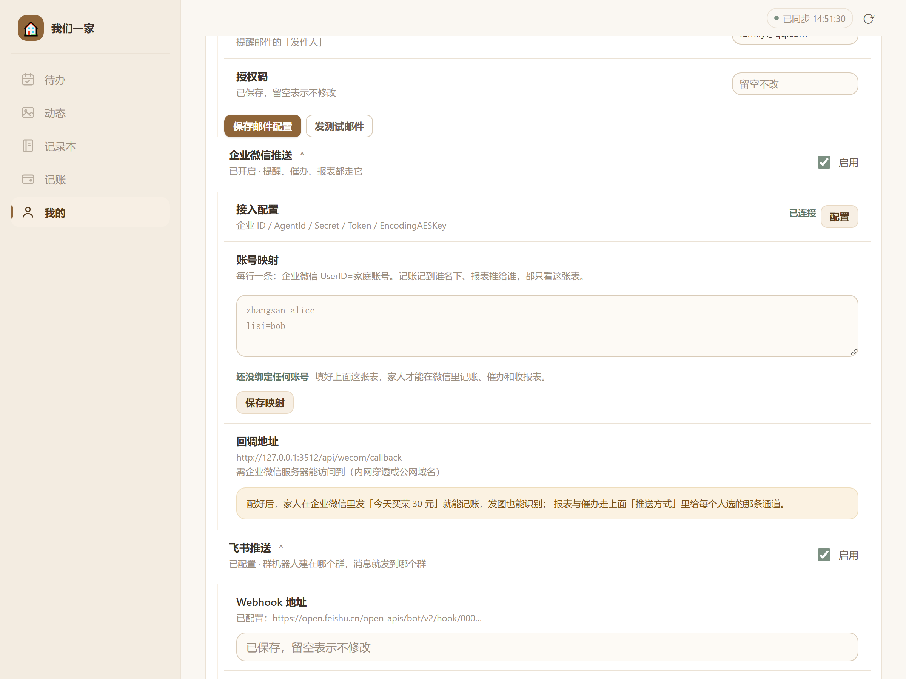
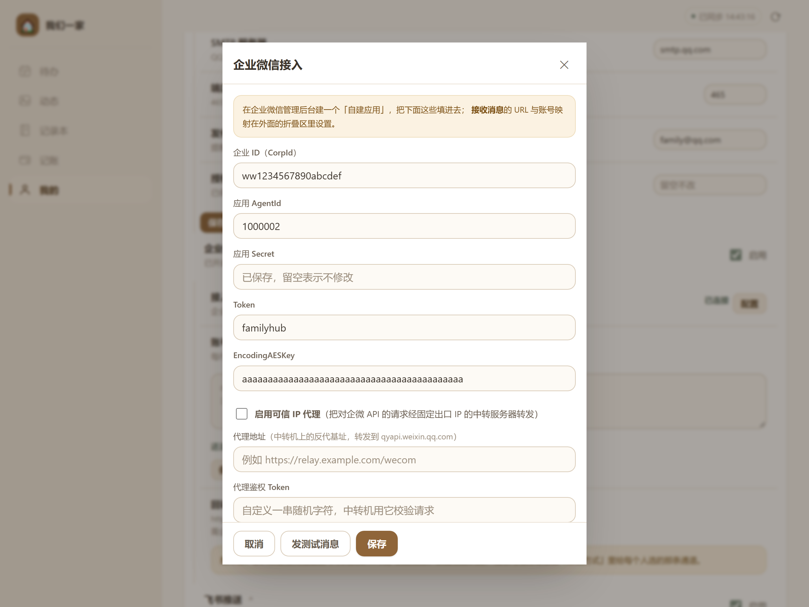
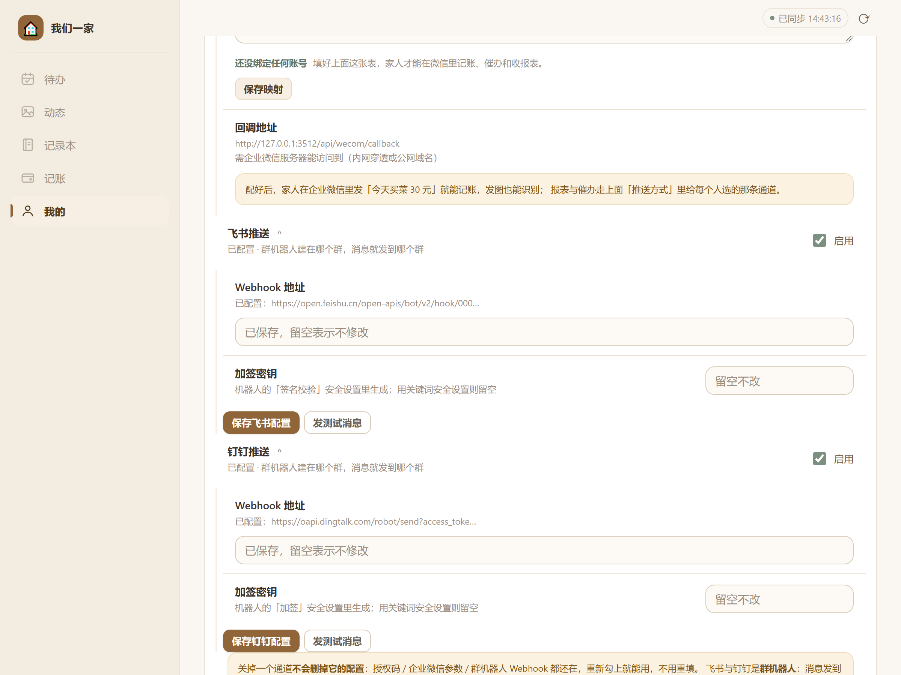

# 教程② 企业微信推送配置（从注册到收发打通）

> 耗时 40–60 分钟（含企业微信侧注册），难度中偏难。
> 一句话：注册企业微信 → 建自建应用 → 五项凭证填进本应用 → 配回调与账号映射，家人就能在微信里收提醒、发一句话记账。

企业微信是**双向**的，两个方向用的配置不一样：

| 方向 | 需要什么 | 坏了的表现 |
| --- | --- | --- |
| ① 我们主动发（提醒 / 报表 / 催办） | CorpId、AgentId、Secret、**企业可信 IP** | 「发测试消息」报错，家人收不到提醒 |
| ② 家人发过来（发消息 / 发图记账） | **公网回调地址**、Token、EncodingAESKey | 测试消息**能收到**，但家人发消息没反应 |

记住这条：**测试消息能收到、发消息没回音，别怀疑凭证，去查回调地址。**

---

## 前置准备

| 准备项 | 要求 |
| --- | --- |
| 企业微信账号 | 手机号即可注册，**不需要营业执照** |
| 公网可达地址 | 只有方向②需要；纯内网 IP 不行 |
| 服务器出网 | 能访问 `qyapi.weixin.qq.com:443` |
| 管理员权限 | 「推送渠道设置」只对管理员可见 |
| 家人已入企业 | 通讯录里有他们，且在应用可见范围内 |

> 只想收提醒和报表、不在微信里发消息？可以先不做回调，方向①照样能用。
> 家宽是动态 IP 的，还要做「可信 IP 代理」，见 [教程③](03-企业微信消息代理.md)。

---

## 第 1 步：注册企业微信

官方入口：<https://work.weixin.qq.com/> → 右上角 **立即注册**。

企业名称随便写（例如 `张家小院`，会显示在消息来源里），行业任选，人员规模选最小；用微信扫码验证后进入管理后台。

> **不需要企业认证**。自建应用、发消息、收消息这些能力，未认证企业就能用。

---

## 第 2 步：拿到企业 ID（CorpId）

后台 **我的企业 → 企业信息** → 页面底部「企业 ID」，形如 `ww1234567890abcdef`。

---

## 第 3 步：创建自建应用

**应用管理 → 自建 → 创建应用**：

- **应用名称**：例如 `我们一家`（会出现在家人的消息通知里）。
- **可见范围**：**必须包含所有要收消息的家人**。漏了会报 `81013 UserID 不存在`。
- 创建后记下两个值：**AgentId**（纯数字，如 `1000002`）、**Secret**（点「查看」，企业微信会发给你）。

> Secret 只显示一次，丢了就点重置，重置后旧值立即失效。

---

## 第 4 步：把凭证填进应用

路径：**我的 → 推送渠道设置 → 企业微信推送 → 配置**。



*📷 图 1：「企业微信推送」区块：接入配置、账号映射、回调地址三部分。图源：本机 v5.0.0 实拍（演示端口）。*



*📷 图 2：「企业微信接入」弹窗：五项凭证 + 可信 IP 代理三件套。图源：本机 v5.0.0 实拍（值为演示占位）。*

| 字段 | 填什么 | 校验 |
| --- | --- | --- |
| 企业 ID（CorpId） | `ww…` | 最长 64 字符 |
| 应用 AgentId | 纯数字 | 非数字直接报错 |
| 应用 Secret | 第 3 步的 Secret | 保存后不回显 |
| Token | 下一步自己生成或随机获取 | 3–32 位字母数字 |
| EncodingAESKey | 下一步随机获取 | **必须正好 43 位** |

点 **保存**，状态从「配置不完整」变成「已连接」。注意：**已连接只代表五项齐了，不代表真能发**。

---

## 第 5 步：配置回调（决定家人能不能发消息过来）

顺序很关键：**先在本应用填好 Token 与 AESKey，再回企业微信点保存触发验证**。

1. 企业微信应用详情页 → **接收消息 → 设置 API 接收**。
2. **Token** 点「随机获取」；**EncodingAESKey** 点「随机获取」，得到 43 位；消息加解密方式保持 **安全模式**。
3. 把这两个值抄回本应用（见第 4 步），保存。
4. 回到企业微信，**URL** 填 `https://你的域名/api/wecom/callback`；挂在子路径下时前缀不能少，例如 `https://域名/familyhub/api/wecom/callback`（本应用界面上的「回调地址」一行可直接照抄）。
5. 点 **保存**。企业微信会立刻发一个 GET 验证请求，通过才算保存成功。

验证成功的前提：服务在跑、公网能访问、两边 Token 与 AESKey 一字不差。

---

## 第 6 步：填账号映射（谁是谁）

企业微信只知道 `UserID`，不知道对应本应用哪个账号。

1. 企业微信后台 **通讯录** → 点成员 → 详情页的 **账号**（UserID），形如 `ZhangSan`，大小写敏感。
2. 在本应用「账号映射」里每行一条：`企业微信UserID=家庭用户名`。

```
ZhangSan=zhangsan
LiSi=lisi
```

点 **保存映射**，下方显示「已绑定 N 个账号」。



*📷 图 3：同一页面向下滚，可以看到账号映射的绑定状态与回调地址一行。图源：本机 v5.0.0 实拍。*

> 绑定后，家人在企业微信发「今天买菜 30 元」就能记账，发小票照片可走 AI 识别（见 [教程⑤](05-AI接入-千问.md)）。

---

## 第 7 步：配企业可信 IP

企业微信会校验调用方 IP，不在白名单就返回 `60020`。

1. 应用详情页 → **企业可信 IP → 配置**。
2. 填入本应用的**公网出口 IP**（不是内网 IP、不是域名）。

查出口 IP，在跑应用的机器上执行：

```bash
curl -s https://ifconfig.me
```

> IP 天天变怎么办？做一台固定 IP 的中转机，只把中转机 IP 填进白名单 —— 见 [教程③](03-企业微信消息代理.md)。

---

## 第 8 步：验证

1. **主动发**：弹窗底部点「发测试消息」，映射到自己的那个 UserID 应收到消息。
2. **收消息**：让已映射的家人在企业微信给应用发 `今天买菜 30 元`，记账里应多一笔支出。
3. **推送落地**：家人把「推送方式」改成「仅企业微信」或「邮件 + 企业微信」，造一条 5 分钟后的待办，到点看是否收到。

---

## 排查

| 现象 | 原因 | 怎么办 |
| --- | --- | --- |
| `60020` 不在可信 IP 白名单 | 出口 IP 没加，或家宽 IP 变了 | 加白名单；不稳定就上教程③ |
| `81013 UserID 不存在` | 映射写错大小写 / 成员不在可见范围 / 不是本企业成员 | 按这三条顺序查 |
| 取 access_token 失败 `40001` | Secret 错或已被重置 | 重新复制 Secret |
| 取 access_token 失败 `40013` | CorpId 填错（或填成了 AgentId） | 回「我的企业 → 企业信息」复制 |
| `EncodingAESKey 必须是 43 位` | 复制少了字符或带了空格 | 重新随机获取、去空格 |
| `Token 只能是 3-32 位字母或数字` | Token 里有 `-` `_` | 用随机获取，或改成纯字母数字 |
| 企业微信点保存时 URL 验证失败 | 服务没跑 / 公网不通 / 前缀漏了 / 两边值不一致 | 浏览器先打开回调地址；核对前缀与两个值 |
| 测试消息成功，但家人发消息没反应 | 回调方向没通 | 看服务日志有没有 `/api/wecom/callback` 请求 |
| 保存映射后仍显示「还没绑定任何账号」 | 用了全角等号或冒号 | 必须半角 `=`，每行一条 |

错误码查不完时用官方工具：<https://open.work.weixin.qq.com/devtool/query>。

---

## 验收清单

- [ ] 企业微信已注册，拿到 CorpId
- [ ] 自建应用已建，AgentId / Secret 已记录，可见范围含所有家人
- [ ] 五项凭证已填，状态「已连接」
- [ ] 回调 URL 保存成功（无验证失败）
- [ ] 账号映射显示「已绑定 N 个账号」
- [ ] 企业可信 IP 已加入服务器出口 IP
- [ ] 「发测试消息」能收到
- [ ] 家人发「今天买菜 30 元」能记账，到点能收到提醒
