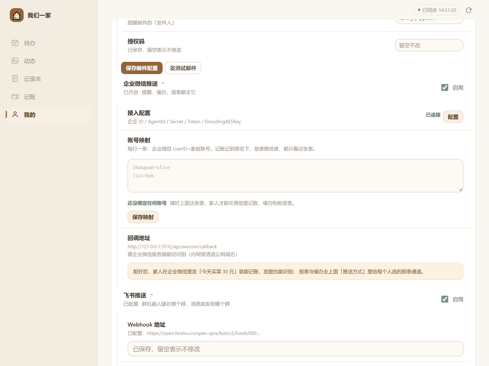
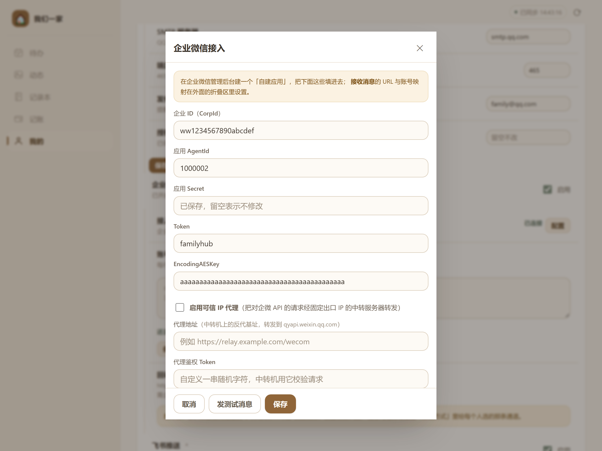
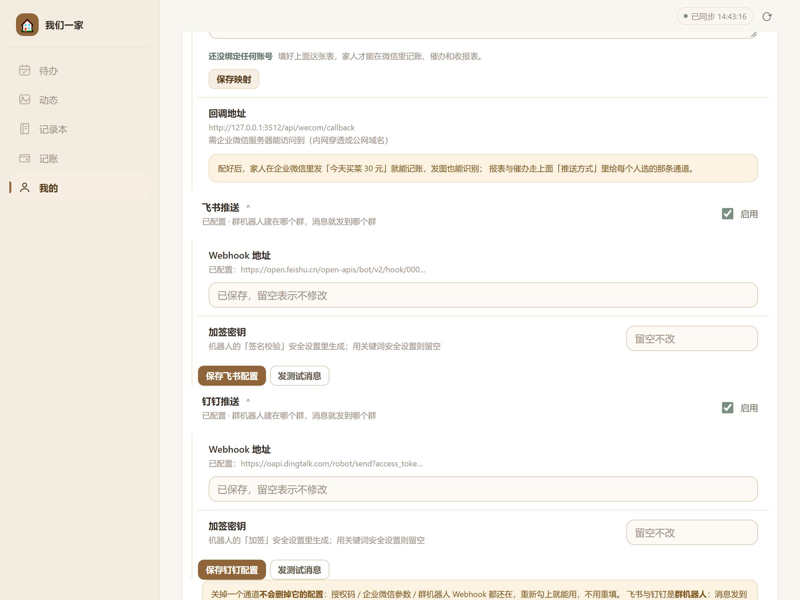

# 教程② 企业微信推送配置（从注册到收发打通）

> 适用版本：**v4.27.0**　｜　预计耗时：40–60 分钟（含企业微信侧注册）　｜　难度：中偏难
> 一句话：注册一个企业微信 → 建一个「自建应用」→ 把五项凭证填进「我们一家」→ 配好回调与账号映射，家人就能在微信里收提醒、发一句话记账。

---

## 一、先搞清楚这条链路长什么样

企业微信这条通道和邮件不一样：邮件是「我们发出去就完事」，企业微信是**双向**的。

```
                        ① 我们主动发（提醒 / 报表 / 催办）
   「我们一家」 ──────────────────────────────────► 企业微信服务器 ──► 家人微信
        ▲            （需要：CorpId + Secret + AgentId + 可信 IP）
        │
        │           ② 家人发过来（发消息 / 发图记账）
        └────────────────────────────────────────── 企业微信服务器
                     （需要：公网可达的回调地址 + Token + EncodingAESKey）
```

**这两条方向用的配置不一样，坏掉的表现也不一样**：

| 方向 | 需要什么 | 坏了会怎样 |
|---|---|---|
| ① 主动发 | CorpId、AgentId、Secret、**企业可信 IP** | 点「发测试消息」报错，家人收不到提醒和报表 |
| ② 收消息 | **公网回调地址**、Token、EncodingAESKey | 点「发测试消息」**是成功的**，但家人在微信里发消息没反应 |

所以：**如果测试消息能收到、但发消息没回音，别怀疑凭证——去查回调地址。**

---

## 二、关于本文截图

| 截图类型 | 来源 | 说明 |
|---|---|---|
| **本项目界面图**（图 1–图 3） | 在本机运行 v4.27.0 真实服务、用 Chrome 实际点击界面截取 | 图中的 CorpId `ww1234567890abcdef`、AgentId `1000002`、回调域名 `127.0.0.1` 全部是**演示占位值** |
| **企业微信管理后台** | **不提供截图** | 企业微信后台改版频繁，贴图容易误导。本文给出「菜单路径 + 字段名 + 该字段长什么样」的文字描述，并附官方文档链接，请以你实际界面为准 |

---

## 三、前置准备

| 准备项 | 要求 | 为什么 |
|---|---|---|
| **一个企业微信账号** | 手机号即可注册，**不需要企业营业执照** | 家庭用途写「XX 家」也能注册成功 |
| **公网可访问的地址** | 域名或内网穿透地址，**必须能走 HTTPS 或 HTTP 80/443** | 企业微信服务器要主动访问你的 `/api/wecom/callback`；纯内网 IP 不行 |
| **服务器能出网** | 能访问 `qyapi.weixin.qq.com:443` | ① 主动发消息要调它的接口 |
| **管理员权限** | 「我们一家」的管理员 | 「推送渠道设置」只对管理员可见 |
| **家庭成员的微信号** | 让他们加入你的企业微信 | 收消息的载体是「企业微信 App / 微信插件」 |

> **没有公网地址怎么办？**
> 只有「② 收消息」才需要公网地址。如果你只想**收提醒和报表**、不需要在微信里发消息记账，可以先不做回调——① 那条方向照样能用。
> 但如果 IP 不固定（家宽动态 IP），还要额外做「可信 IP 代理」，见 **教程③**。

---

## 四、第 1 步：注册企业微信

> 官方入口：<https://work.weixin.qq.com/> → 右上角「立即注册」

1. 打开 <https://work.weixin.qq.com/>，点 **「立即注册」**。
2. 填写注册信息：
   - **企业名称**：家庭用途随便写，例如 `张家小院`。这个名字会显示在家人收到的消息来源里。
   - **行业**：任选，例如「其他」。
   - **人员规模**：选最小的那档。
   - **管理员姓名**、**手机号**：填你自己的。
3. 用**微信扫码**完成身份验证，提交。
4. 注册成功后，你会进入企业微信管理后台（网址形如 `https://work.weixin.qq.com/wework_admin/frame`）。

> **必须做企业认证吗？**
> 不用。**自建应用 + 发消息 + 收消息**这些能力，未认证企业就能用。
> 认证（要营业执照或对公打款）只在你要用「客户联系」「外部群」这类对外能力时才需要。

---

## 五、第 2 步：拿到「企业 ID（CorpId）」

1. 后台顶部菜单 → **「我的企业」** → **「企业信息」**。
2. 页面底部有 **「企业 ID」**，形如 `ww1234567890abcdef`（`ww` 开头的一串字母数字）。
3. 复制它。

这个值要填进「我们一家」的 **「企业 ID（CorpId）」** 栏。

---

## 六、第 3 步：创建一个自建应用

1. 后台顶部菜单 → **「应用管理」** → 在「应用」区域找到 **「自建」** → 点 **「创建应用」**。
2. 填写：
   - **应用 logo**：随便传一张（家人收到消息时显示的就是它）。
   - **应用名称**：例如 `我们一家`。**这个名字会出现在家人微信的消息通知里**，建议起得直白些。
   - **可见范围**：**必须包含所有要收消息的家庭成员**。这一步最容易漏——可见范围外的人，即使账号映射填对了，接口也会报 `81013 UserID 不存在`。
3. 点「创建应用」。
4. 进入应用详情页，记下两个值：

| 字段 | 长相 | 填到「我们一家」的哪一栏 |
|---|---|---|
| **AgentId** | 纯数字，例如 `1000002` | 「应用 AgentId」 |
| **Secret** | 一串长字符（点「查看」后企业微信会发到你的企业微信里） | 「应用 Secret」 |

> **Secret 只显示一次**（或需要从企业微信 App 里复制）。丢了就点「重置」，重置后旧值立即失效，记得回来更新。

---

## 七、第 4 步：配置「接收消息」（决定家人能不能发消息过来）

这一步的顺序**非常关键**，反了会一直验证失败：

> **正确顺序**：先在「我们一家」里填好 Token 与 EncodingAESKey → 再到企业微信点「保存」触发验证。

### 4.1 先在企业微信里生成 Token 与 EncodingAESKey

1. 在应用详情页往下滚，找到 **「接收消息」** 区域 → 点 **「设置 API 接收」**。
2. 页面上有三个输入框：

| 字段 | 怎么填 |
|---|---|
| **URL** | 先留空或填占位（下一步才回来填真值）。形如 `https://你的域名/api/wecom/callback` |
| **Token** | 点旁边的 **「随机获取」**，或自己填 3–32 位字母/数字（本项目要求：`A-Za-z0-9`，长度 3–32） |
| **EncodingAESKey** | 点 **「随机获取」**，得到 43 位字符（含字母、数字、`+`、`/`）。**必须正好 43 位**，本项目会直接校验长度 |

3. **先把这两个值抄下来**，别急着点保存。
4. **消息加解密方式选「安全模式」**（默认就是）。本项目实现了 AES 解密，安全模式工作正常；选「明文模式」则需要改代码，不建议。

### 4.2 回到「我们一家」把五项凭证填进去

路径：**我的 → 推送渠道设置 → 企业微信推送 → 接入配置 → 「配置」按钮**



*📷 图 1：「企业微信推送」区块完整样子——顶部是「接入配置」（右侧状态徽标 + 「配置」按钮），中间是「账号映射」多行输入框与绑定状态，底部是「回调地址」。图源：本机 v4.27.0 实拍（回调地址中的 127.0.0.1:3512 是本机演示端口，真实环境是你的公网域名）。*

点「配置」打开弹窗：



*📷 图 2：「企业微信接入」弹窗。五个凭证字段 + 可信 IP 代理三件套。图源：本机 v4.27.0 实拍（值均为演示占位）。*

按顺序填：

| 界面字段 | 填什么 | 校验规则 |
|---|---|---|
| **企业 ID（CorpId）** | 第 2 步的 `ww…` | 最长 64 字符 |
| **应用 AgentId** | 第 3 步的纯数字 | **必须是纯数字**，否则报「应用 AgentId 应为纯数字」 |
| **应用 Secret** | 第 3 步的 Secret | 保存后不回显，显示「已保存，留空表示不修改」 |
| **Token** | 4.1 抄下的 Token | 3–32 位字母或数字 |
| **EncodingAESKey** | 4.1 抄下的 43 位 | **必须 43 位**，含 `+` `/` 也是合法字符 |

填完先点 **「保存」**（弹窗底部）。此时界面上的状态会从「配置不完整」变成「已连接」。

> ⚠️ **「已连接」不等于「真的能发」**。它只表示五项配置**齐了**。真能不能发，要靠后面的「发测试消息」来验证。

### 4.3 再回企业微信填 URL 并保存

1. 回到企业微信那个「设置 API 接收」页面。
2. **URL** 填：`https://你的公网域名/api/wecom/callback`
   - 如果你用反代 / 飞牛网关挂在了子路径下（例如 `/familyhub`），**必须带上前缀**：`https://你的域名/familyhub/api/wecom/callback`。
   - 这个地址在「我们一家」的界面上是**直接显示出来的**（图 1 里「回调地址」那一行），照抄即可。
3. 点 **「保存」**。
4. 企业微信会立刻向你的 URL 发一个 `GET` 验证请求。**验证通过**才会提示保存成功。

验证成功的前提是：服务正在运行、公网能访问、Token 与 AESKey 两边一致。

---

## 八、第 5 步：填「账号映射」（决定「谁是谁」）

企业微信只知道一个 `UserID`（比如 `ZhangSan`），它不知道这对应「我们一家」里的哪个账号。这张映射表就是唯一的认人依据。

### 5.1 先查家人的企业微信 UserID

1. 企业微信后台 → **「通讯录」** → 点某个成员。
2. 在成员详情页找到 **「账号」**（UserID），形如 `ZhangSan` 或 `zhangsan`（注意大小写）。
3. 把每个要使用的人记下来。

> 成员必须先被邀请进企业（通讯录里有他），并且**在第 3 步应用的「可见范围」内**。

### 5.2 填进「我们一家」

在「企业微信推送」区块里，找到 **「账号映射」** 多行输入框，**每行一条**：

```
ZhangSan=zhangsan
LiSi=lisi
```

格式是 `企业微信UserID=家庭账号`：

- 左边：企业微信的 UserID（第 5.1 步查到的）
- 右边：**「我们一家」的用户名**（登录时用的那个，不是昵称）

填完点 **「保存映射」**。下方会显示「已绑定 N 个账号」。



*📷 图 3：同一页面向下滚，可以看到上面账号映射的绑定状态，以及「回调地址」那一行——它就是你要填进企业微信的那个 URL。图源：本机 v4.27.0 实拍。*

> **绑定之后能做什么？** 家人在企业微信里发「今天买菜 30 元」就能记账；发一张小票照片，AI 会识别成账单（见教程⑤）。记账记到谁名下、报表推给谁，都只看这张表。

---

## 九、第 6 步：配「企业可信 IP」（主动发消息的通行证）

企业微信会检查「调用接口的服务器 IP」，不在白名单里就返回 `60020`。

1. 企业微信后台 → 应用详情页 → 找到 **「企业可信 IP」** → **「配置」**。
2. 填入你服务器的**公网出口 IP**（不是内网 IP，也不是域名）。
3. 保存。

**怎么知道自己的出口 IP？** 在跑「我们一家」的那台机器上执行：

```bash
curl -s https://ifconfig.me
```

> **家宽是动态 IP，天天变怎么办？**
> 两种办法：
> - 每次变了就回来改（累）；
> - **做一台固定 IP 的中转服务器，只把中转机的 IP 填进白名单** —— 这就是「可信 IP 代理」，完整代码与部署步骤见 **教程③**，配好后这里只需要填中转机的 IP。

---

## 十、第 7 步：验证

### 7.1 验证「主动发」

回到「企业微信接入」弹窗，点底部 **「发测试消息」**。

- **成功**：消息出现在你（映射到自己账号的那个 UserID）的企业微信里。
- **失败**：弹窗会给出人话提示，对照第十一节的表。

### 7.2 验证「收消息」

1. 确认企业微信「设置 API 接收」页面已显示**保存成功**（说明 URL 验证通过）。
2. 让已映射的家人在企业微信里给这个应用发一句：`今天买菜 30 元`。
3. 打开「我们一家」→「记账」，应该多出一笔 30 元的支出。

### 7.3 验证「推送落地」

1. 让某位家人进 **我的 → 消息推送设置 → 推送方式**，选「仅企业微信」或「邮件 + 企业微信」。
2. 造一条 5 分钟后的待办。
3. 到点后到企业微信里看是否收到。

---

## 十一、关键配置项说明

| 界面字段 | 服务端键 | 约束 | 用在哪 |
|---|---|---|---|
| 企业微信推送「启用」 | `push_wecom_enabled` | — | **唯一总开关**：关掉等于整体停用（连回消息也停） |
| 企业 ID | `wecom_corp_id` | 64 字符内 | 取 access_token |
| 应用 AgentId | `wecom_agent_id` | **纯数字** | 发消息时指定「用哪个应用发」 |
| 应用 Secret | `wecom_secret` | 128 字符内 | 取 access_token（有效期 7200s，提前 5 分钟续） |
| Token | `wecom_token` | 3–32 位字母数字 | 回调签名校验 |
| EncodingAESKey | `wecom_aes_key` | **恰好 43 位** | 回调解密 / 回复加密 |
| 账号映射 | `wecom_user_map` | 每行 `UserID=用户名` | 唯一认人依据 |
| 可信 IP 代理开关 | `wecom_proxy_enabled` | `1` / `0` | 见教程③ |
| 代理地址 | `wecom_proxy_url` | `http(s)://` 开头 | 见教程③ |
| 代理鉴权 Token | `wecom_proxy_token` | — | 请求头 `X-FH-Proxy-Token` |

四个「必须理解」的行为：

1. **关闭推送开关 = 整体停用**。不是「只停推送」——家人发消息也不会被处理。要临时停止骚扰又想保留记账能力，请改个人推送方式，不要关总开关。
2. **Secret 只写不读**。保存后再打开弹窗只显示「已保存，留空表示不修改」。要换就填新的，不换就留空。
3. **AgentId 非数字直接被拒**。别把「应用名称」填进去。
4. **回调地址带前缀**。用反代 / 网关子路径部署时，回调地址必须与页面显示的一致，否则企业微信验证 404。

---

## 十二、常见问题排查

| 现象 / 报错 | 原因 | 怎么办 |
|---|---|---|
| 弹窗提示 **服务器 IP 不在应用的「企业可信 IP」白名单里**（errcode 60020） | 出口 IP 没加白名单，或家宽 IP 变了 | 第九节：把 `curl ifconfig.me` 的结果加进应用的可信 IP；变量太大就上教程③的代理 |
| 提示 **企业微信说这个 UserID 不存在**（errcode 81013） | ① 映射表左边写错（大小写敏感）② 该成员不在应用「可见范围」内 ③ 不是本企业成员 | 按 ①②③ 顺序检查 |
| 提示 **取 access_token 失败：40001** | Secret 错了 / 被重置过 | 重新复制 Secret，填进去保存 |
| 提示 **取 access_token 失败：40013** | CorpId 错了（或填成了 AgentId） | 回「我的企业 → 企业信息」重新复制 |
| 提示 **EncodingAESKey 必须是 43 位** | 复制时少了字符，或带了空格 | 回企业微信点「随机获取」重新复制，注意去掉首尾空格 |
| 提示 **Token 只能是 3-32 位字母或数字** | Token 里有 `-` `_` 等字符 | 用企业微信「随机获取」生成，或改成纯字母数字 |
| **企业微信点「保存」时提示 URL 验证失败** | ① 服务没跑 ② 公网访问不到 ③ 前缀漏了 ④ Token/AESKey 两边不一致 | 先在浏览器打开回调地址看是否有响应；确认子路径前缀；确认两边值逐字一致 |
| **发测试消息成功，但家人发消息没反应** | 回调方向没通（URL 没保存成功 / 服务重启后没恢复） | 看服务日志里是否有 `/api/wecom/callback` 的请求记录 |
| **企微能发，但提示「保存映射」后仍显示「还没绑定任何账号」** | 映射行格式不对（用了全角等号、冒号） | 必须是半角 `=`，每行一条，不要逗号不要引号 |
| 家人收到了消息，但点进去是空白 | 应用「可见范围」不含他，或他用的不是企业微信 App | 检查可见范围；让他在微信「企业微信插件」里查看 |

**企业微信的错误码一律是数字**，看到数字先查「怎么办」那一列；本项目已把 81013 / 60020 / 45009 翻译成人话，如果看到纯数字，说明是没收录的码，可到 <https://open.work.weixin.qq.com/devtool/query> 查。

---

## 十三、验收清单

- [ ] 企业微信已注册，拿到 CorpId
- [ ] 自建应用已创建，拿到 AgentId 与 Secret，且**可见范围包含所有家人**
- [ ] 「设置 API 接收」里 URL / Token / EncodingAESKey 三项已填，**保存成功**（无验证失败）
- [ ] 「我们一家」里五项凭证已填，状态显示「已连接」
- [ ] 账号映射每人一行，显示「已绑定 N 个账号」
- [ ] 「企业可信 IP」里已加入服务器出口 IP
- [ ] 点「发测试消息」，企业微信里能收到
- [ ] 家人在企业微信发「今天买菜 30 元」，记账里出现该笔
- [ ] 造一条待办，到点能收到企微提醒

---

## 附：本文依据

- 界面字段与文案：`family-hub/public/app.js`（`wecomSectionInner` / `openWecomForm` 两段）
- 配置键、校验规则、错误码翻译：`family-hub/src/wecom.js`（`CONFIG_KEYS`、`saveConfig`、`friendlyError`）
- 回调路由：`family-hub/src/wecom.js` 的 `'/api/wecom/callback'`，由 `server.js` 在剥离 BASE_PATH 后、会话中间件之前单独分支处理（XML 请求、无 Cookie）
- 企业微信官方文档：<https://developer.work.weixin.qq.com/document/path/90664>（自建应用）、<https://developer.work.weixin.qq.com/document/path/90930>（接收消息）
