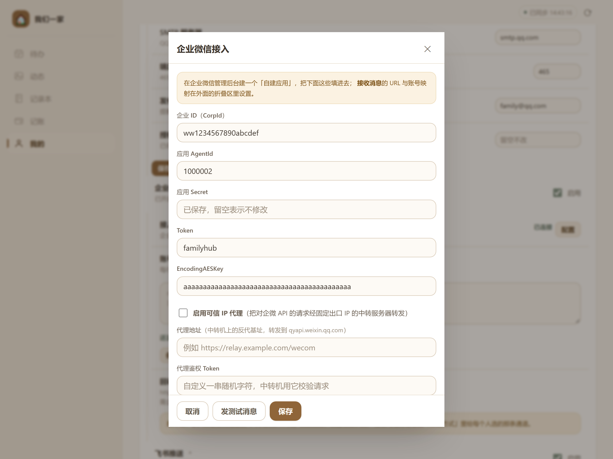

# 教程③ 企业微信消息代理：代码与部署说明

> 适用版本：**v4.27.0**（服务端 `src/wecom.js` 的「可信 IP 代理」特性，v4.24.0 引入）
> 预计耗时：30 分钟（含云服务器开机器）　｜　难度：中
> 一句话：把「我们一家」调用企业微信接口的请求，绕到一台**固定公网 IP** 的中转机上，从此企业微信白名单只需要维护一个 IP。

---

## 一、为什么需要它

企业微信的安全策略是：**调用 API 的服务器 IP 必须在该应用的「企业可信 IP」白名单里**。

这在公司里不是问题（固定出口 IP），在家里很麻烦：

| 家里的情况 | 结果 |
|---|---|
| 家宽是动态 IP，运营商隔几天换一次 | 企业微信报 `60020 不合法的IP`，推送全挂，得回后台改白名单 |
| 机器在路由器 NAT 后面，出口 IP 与别人共用 | 同上，而且换的是整个小区出口，你控制不了 |
| 双宽带 / 4G 备份切换 | 一切换就报错 |
| NAS 换机器、换网络 | 又要改一次 |

「可信 IP 代理」的思路很直接：**找一台 IP 不变的机器（云服务器）替你出面**。家里机器把所有 `qyapi.weixin.qq.com` 的请求发给它，它原样转发；企业微信看到的永远是这台云服务器的 IP。

```
                        ┌──────────────────────────┐
   家里 NAS（动态 IP）   │  云服务器（固定公网 IP）  │        企业微信
   「我们一家」  ──────► │  中转程序 / nginx         │ ─────►  qyapi.weixin.qq.com
        发送请求         │  校验令牌 → 透明转发      │        只看到云服务器的 IP
                        └──────────────────────────┘
```

> ⚠️ **它只解决「往外发」这一个方向。**
> 企业微信**回调**你（家人在微信里发消息 → 你的服务）是反方向，**不走代理**，仍然需要你的地址公网可达（域名 + 内网穿透，或直接公网 IP）。
> 所以：代理解决「推送发不出去」，不解决「收不到消息」。

---

## 二、它怎么和「我们一家」对接（协议）

这不是自定义协议，而是「把 base URL 换掉」这么简单。看服务端实现就三层：

```js
// family-hub/src/wecom.js
const API_BASE = 'https://qyapi.weixin.qq.com';

function apiBaseOf(cfg) {
  if (cfg && cfg.proxyEnabled && cfg.proxyUrl) return String(cfg.proxyUrl).replace(/\/+$/, '');
  return API_BASE;
}
function proxyHeaders(cfg) {
  if (cfg && cfg.proxyEnabled && cfg.proxyToken) {
    return { 'X-FH-Proxy-Token': cfg.proxyToken };
  }
  return {};
}
```

由此推导出中转机必须满足的全部契约：

| 契约 | 具体要求 |
|---|---|
| **路径映射** | `POST/GET <代理地址> + 原路径` → 转发到 `https://qyapi.weixin.qq.com + 原路径` |
| **查询串** | 原样保留（`corpid`、`corpsecret`、`access_token` 都在 query 里） |
| **鉴权头** | 请求带 `X-FH-Proxy-Token: <令牌>`，中转机必须校验 |
| **响应** | 原样返回（JSON 与 HTTP 状态码都要保留，客户端靠 `errcode` 判断） |
| **不发的东西** | 回调（`/api/wecom/callback`）永远不走代理 |

举例，启用后实际发出的请求是：

```
https://relay.example.com/wecom/cgi-bin/gettoken?corpid=ww…&corpsecret=…
                                                        ▲
                                        这里就是界面里填的「代理地址」+ 原路径
```

---

## 三、前置准备

| 准备项 | 要求 | 说明 |
|---|---|---|
| **一台固定公网 IP 的服务器** | 任意云厂商最低配即可（1 核 1G 足够） | 它只做转发，不存数据、不落盘 |
| **一个域名 + HTTPS** | 强烈建议；也可用 IP + 自签（不推荐） | 「我们一家」会往这个地址发 Secret，**不要用 http 明文** |
| **Node.js ≥ 18**（走方案 A） | 或直接用 nginx（方案 B） | 方案 A 零依赖，单文件即可跑 |
| **已配好的企业微信自建应用** | 见教程② | 需要 CorpId / AgentId / Secret |

> **能不能不用云服务器？**
> 不能。这个方案的**全部价值**就是「IP 不变」。用家里的机器当中转，等于没做。

---

## 四、方案 A：Node 单文件中转（推荐，零依赖）

完整可运行代码在仓库里：**`docs/tutorials/tools/wecom-relay.js`**（约 130 行，只用 Node 内置模块，`npm install` 都不用）。全文如下，可直接复制：

```js
#!/usr/bin/env node
'use strict';
/**
 * 企业微信 API 中转（可信 IP 代理）· 零依赖 Node 实现
 * 原请求： https://qyapi.weixin.qq.com/cgi-bin/gettoken?corpid=…&corpsecret=…
 * 改走后： https://relay.example.com/wecom/cgi-bin/gettoken?corpid=…&corpsecret=…
 *         请求头带 X-FH-Proxy-Token: <你设置的令牌>
 */
const http = require('node:http');
const https = require('node:https');
const crypto = require('node:crypto');
const { URL } = require('node:url');

const PORT = Number(process.env.PORT || 8080);
const HOST = process.env.HOST || '127.0.0.1';
const PREFIX = (process.env.PREFIX || '/wecom').replace(/\/+$/, '');
const UPSTREAM = (process.env.UPSTREAM || 'https://qyapi.weixin.qq.com').replace(/\/+$/, '');
const TOKEN = String(process.env.PROXY_TOKEN || '');

// 只转发企业微信的 API 路径，避免变成通用代理
const ALLOW_PATH = /^\/cgi-bin\/[A-Za-z0-9_./-]+$/;

function tokenOk(given) {
  if (!TOKEN) return true;                       // 没设令牌 = 不校验（仅供内网自测）
  const a = Buffer.from(String(given || ''), 'utf8');
  const b = Buffer.from(TOKEN, 'utf8');
  if (a.length !== b.length) return false;
  return crypto.timingSafeEqual(a, b);
}

function fail(res, code, msg) {
  const body = JSON.stringify({ errcode: code * -1, errmsg: msg });
  res.writeHead(code, { 'Content-Type': 'application/json; charset=utf-8', 'Content-Length': Buffer.byteLength(body) });
  res.end(body);
}

const server = http.createServer((req, res) => {
  // 健康检查：给云厂商的探活 / 自己 curl 用，不需要令牌
  if (req.url === '/healthz') {
    res.writeHead(200, { 'Content-Type': 'text/plain; charset=utf-8' });
    res.end('ok');
    return;
  }

  if (!req.url.startsWith(PREFIX + '/')) return fail(res, 404, 'path not found');
  if (!tokenOk(req.headers['x-fh-proxy-token'])) return fail(res, 401, 'proxy token mismatch');

  const rest = req.url.slice(PREFIX.length);     // /cgi-bin/gettoken?…
  const path = rest.split('?')[0];
  if (!ALLOW_PATH.test(path)) return fail(res, 403, 'only /cgi-bin/* is allowed');

  let target;
  try {
    target = new URL(UPSTREAM + rest);
  } catch {
    return fail(res, 400, 'bad upstream url');
  }

  // 只带必要的头：Authorization / Cookie 之类一律不透传
  const headers = { 'Content-Type': req.headers['content-type'] || 'application/json' };
  if (req.headers['content-length']) headers['Content-Length'] = req.headers['content-length'];

  const up = https.request({
    protocol: target.protocol,
    hostname: target.hostname,
    port: target.port || 443,
    path: target.pathname + target.search,
    method: req.method,
    headers,
    timeout: 15000,
  }, (ur) => {
    res.writeHead(ur.statusCode || 502, ur.headers);
    ur.pipe(res);
  });

  up.on('timeout', () => { up.destroy(new Error('upstream timeout')); });
  up.on('error', (e) => {
    // 只打错误类型，不打 URL（query 里有 corpsecret）
    console.error('[relay] upstream error:', e.code || e.message);
    if (!res.headersSent) fail(res, 502, 'upstream unreachable');
    else res.end();
  });

  req.pipe(up);
});

server.headersTimeout = 20000;
server.requestTimeout = 25000;

server.listen(PORT, HOST, () => {
  console.log(`[relay] listening on http://${HOST}:${PORT}${PREFIX}  ->  ${UPSTREAM}`);
  if (!TOKEN) console.warn('[relay] 警告：未设置 PROXY_TOKEN，任何请求都会被转发。生产环境务必设置。');
});
```

### 4.1 代码里四道「不是装饰」的安全约束

| 约束 | 代码位置 | 不做会怎样 |
|---|---|---|
| 只放行 `/cgi-bin/*` | `ALLOW_PATH` | 它就成了一个**任何人都能用的开放代理**，会被人拿去挖矿、刷流量 |
| 令牌用 `timingSafeEqual` 比较 | `tokenOk()` | 普通 `===` 会在首个不同字符处提前返回，理论上可按响应时间逐字符猜出令牌 |
| 不打印 URL | `up.on('error')` | query 里带着 `corpsecret`，写进日志等于把 Secret 留在磁盘上 |
| 上游写死 https、不接受调用方指定目标 | `https.request(...)` | 否则可被诱导去请求内网地址（SSRF） |

### 4.2 部署（systemd）

```bash
# 1) 把文件传到服务器
sudo mkdir -p /opt/wecom-relay
sudo cp wecom-relay.js /opt/wecom-relay/
sudo useradd -r -s /usr/sbin/nologin relay 2>/dev/null || true

# 2) 生成一个长随机令牌（64 位十六进制）
openssl rand -hex 32
#   例：3f9a…（复制下来，等下要用两次：一次给 systemd，一次填进「我们一家」）

# 3) 写 systemd 单元
sudo tee /etc/systemd/system/wecom-relay.service > /dev/null <<'EOF'
[Unit]
Description=WeCom API relay for family-hub
After=network-online.target
Wants=network-online.target

[Service]
Type=simple
User=relay
Environment=PORT=8080
Environment=HOST=127.0.0.1
Environment=PREFIX=/wecom
Environment=PROXY_TOKEN=把上面生成的令牌粘到这里
ExecStart=/usr/bin/node /opt/wecom-relay/wecom-relay.js
Restart=always
RestartSec=3
NoNewPrivileges=true
PrivateTmp=true
ProtectSystem=strict
ProtectHome=true

[Install]
WantedBy=multi-user.target
EOF

# 4) 启动
sudo systemctl daemon-reload
sudo systemctl enable --now wecom-relay
sudo systemctl status wecom-relay --no-pager

# 5) 自检
curl -s http://127.0.0.1:8080/healthz    # 期望输出 ok
```

> 没装 Node？`apt install nodejs` 或 `curl -fsSL https://deb.nodesource.com/setup_22.x | sudo bash - && apt install nodejs`。版本 ≥ 18 即可。

### 4.3 前面挂 Nginx 上 HTTPS

```nginx
server {
    listen 443 ssl http2;
    server_name relay.example.com;

    ssl_certificate     /etc/letsencrypt/live/relay.example.com/fullchain.pem;
    ssl_certificate_key /etc/letsencrypt/live/relay.example.com/privkey.pem;

    # 只转发 /wecom，其它路径 404
    location /wecom/ {
        proxy_pass http://127.0.0.1:8080;
        proxy_http_version 1.1;
        proxy_set_header Host $host;
        proxy_set_header X-Real-IP $remote_addr;
        proxy_read_timeout 30s;
        client_max_body_size 2m;
    }

    location / { return 404; }
}
```

有了 Nginx，`HOST=127.0.0.1` 就足够安全（8080 不对公网开放）。

### 4.4 Docker 方式（可选）

```dockerfile
FROM node:22-alpine
WORKDIR /app
COPY wecom-relay.js .
ENV PORT=8080 HOST=0.0.0.0 PREFIX=/wecom
EXPOSE 8080
USER node
CMD ["node", "wecom-relay.js"]
```

```bash
docker build -t wecom-relay .
docker run -d --name wecom-relay --restart unless-stopped \
  -p 127.0.0.1:8080:8080 \
  -e PROXY_TOKEN='你的令牌' \
  wecom-relay
```

---

## 五、方案 B：纯 Nginx 反代（不想装 Node 时）

不用写代码，Nginx 本身就是个合格的反向代理。

```nginx
server {
    listen 443 ssl http2;
    server_name relay.example.com;

    ssl_certificate     /etc/letsencrypt/live/relay.example.com/fullchain.pem;
    ssl_certificate_key /etc/letsencrypt/live/relay.example.com/privkey.pem;

    location /wecom/ {
        # 令牌校验：不匹配直接 401，不往下走
        if ($http_x_fh_proxy_token != "把令牌粘到这里") {
            return 401 '{"errcode":-401,"errmsg":"proxy token mismatch"}';
        }

        # 只允许 /cgi-bin/ 下的路径（防止被当成开放代理）
        if ($uri !~ "^/wecom/cgi-bin/") {
            return 403 '{"errcode":-403,"errmsg":"only /cgi-bin/* is allowed"}';
        }

        # 注意 proxy_pass 末尾的斜杠：它会把 /wecom/ 前缀替换掉
        proxy_pass https://qyapi.weixin.qq.com/;
        proxy_ssl_server_name on;
        proxy_set_header Host qyapi.weixin.qq.com;
        proxy_set_header Content-Type $content_type;
        proxy_read_timeout 30s;
        proxy_connect_timeout 10s;

        # 不要把请求头原样透传给上游（避免带出无关头）
        proxy_pass_request_headers off;
    }

    location / { return 404; }
}
```

**方案 B 与方案 A 的差别**

| | 方案 A（Node） | 方案 B（Nginx） |
|---|---|---|
| 依赖 | Node ≥ 18 | 只要 Nginx |
| 令牌比较 | 常量时间（更严谨） | 字符串比较 |
| 上游 DNS 变化 | 每次请求都解析 | **启动时解析，需 `nginx -s reload`** |
| 日志泄漏风险 | 已显式规避 | Nginx access log 会记录完整 URL（含 `corpsecret`），需单独关掉该 location 的日志 |
| 建议 | 优先选 | 不想装 Node 时用 |

> 方案 B 的日志问题要特别注意：Nginx 默认会把完整请求行写进 `access.log`，而 `corpsecret` 在 query 里。用方案 B 时请在该 `location` 内加一行 `access_log off;`。

---

## 六、启用：在「我们一家」里填三样东西

路径：**我的 → 推送渠道设置 → 企业微信推送 → 接入配置 →「配置」**



*📷 图 1：弹窗下半部分就是代理的三件套：「启用可信 IP 代理」勾选框、代理地址、代理鉴权 Token。图源：本机 v4.27.0 实拍（值为演示占位）。*

| 界面字段 | 填什么 | 注意 |
|---|---|---|
| **启用可信 IP 代理** | 打勾 | 不打勾则三件套全部忽略，直连 qyapi |
| **代理地址** | `https://relay.example.com/wecom` | 必须以 `http(s)://` 开头；**结尾不要带斜杠**（服务端会自动去掉，但填错容易多一层） |
| **代理鉴权 Token** | 第四节的 `PROXY_TOKEN` | 显示为密码框，保存后不回显，留空表示不修改 |

保存后点 **「发测试消息」** 验证。

---

## 七、验证：三条命令证明它真的通了

以下命令在**中转服务器**上执行。注意 `--noproxy '*'` 只在开发机上需要（本机可能设了 http_proxy），服务器上可省略。

### 7.1 健康检查

```bash
curl -s http://127.0.0.1:8080/healthz
# 期望：ok
```

### 7.2 令牌与白名单（应该被拦住）

```bash
# 不带令牌 → 401
curl -s -o /dev/null -w '%{http_code}\n' \
  'http://127.0.0.1:8080/wecom/cgi-bin/gettoken?corpid=demo&corpsecret=demo'
# 期望：401

# 路径不在 /cgi-bin/ 下 → 403
curl -s -o /dev/null -w '%{http_code}\n' \
  -H 'X-FH-Proxy-Token: 你的令牌' \
  'http://127.0.0.1:8080/wecom/evil/path'
# 期望：403
```

### 7.3 真的转发到企业微信了（最关键的一条）

```bash
curl -s -H 'X-FH-Proxy-Token: 你的令牌' \
  'http://127.0.0.1:8080/wecom/cgi-bin/gettoken?corpid=wwdemo&corpsecret=demo'
```

因为 `wwdemo` 是个假企业，企业微信会返回**它自己的错误**——这恰恰证明转发链路是通的：

```json
{"errcode":40013,"errmsg":"invalid corpid, hint: [...], from ip: x.x.x.x, more info at https://open.work.weixin.qq.com/devtool/query?e=40013"}
```

> 📌 **`from ip` 就是企业微信看到的出口 IP**——也正是你该填进「企业可信 IP」白名单的那个地址。
> 这条命令顺带把「白名单填什么」这个最常见的问题一次性解决了：**把这条响应里的 `from ip` 抄进白名单**。

如果这一步返回 502，说明中转机能出去但连不上企业微信（DNS / 出网被拦）；如果返回 401/403，说明请求没通过中转机自己的校验。

---

## 八、关键配置项说明

| 环境变量 / 界面字段 | 默认 | 说明 |
|---|---|---|
| `PORT` | `8080` | 中转程序监听端口 |
| `HOST` | `127.0.0.1` | 只在本机监听，前面由 Nginx 终止 TLS。改成 `0.0.0.0` 就是直接对外，**务必自己上 TLS** |
| `PREFIX` | `/wecom` | 对外路径前缀，必须与界面「代理地址」的结尾一致 |
| `UPSTREAM` | `https://qyapi.weixin.qq.com` | 上游地址，只在自测时改 |
| `PROXY_TOKEN` | 空 | **必填**。不设则任何请求都能转发（程序会告警） |
| 界面「启用可信 IP 代理」 | 关 | 打开后所有 qyapi 请求改走代理 |
| 界面「代理地址」 | 空 | 必须以 `http(s)://` 开头，服务端会校验并去掉尾部斜杠 |
| 界面「代理鉴权 Token」 | 空 | 写进请求头 `X-FH-Proxy-Token`；只写不读 |

**代理不影响的三件事**（经常被误解）：

1. **回调地址不变**。企业微信仍然直接访问你的 `/api/wecom/callback`，公网可达是前提。
2. **邮件 / 飞书 / 钉钉不走代理**。它们各自直连，只有企业微信这一条受影响。
3. **不需要重启「我们一家」**。保存配置后下一次请求就生效（access_token 缓存按 `corpId|secret|proxyUrl` 区分，改代理地址会让缓存自动失效）。

---

## 九、常见问题排查

| 现象 | 原因 | 怎么办 |
|---|---|---|
| 「发测试消息」提示 **proxy token mismatch** 或 401 | 界面里的令牌与 `PROXY_TOKEN` 不一致（多了空格 / 少了几位） | 两边逐字核对；重设令牌后记得两边都改 |
| 提示 **HTTP 404 path not found** | 代理地址结尾与 `PREFIX` 不匹配（比如程序是 `/wecom`，界面填了 `/relay`） | 把界面「代理地址」改成 `https://域名/wecom` |
| 提示 **only /cgi-bin/* is allowed**（403） | Nginx 方案里 `location` 前缀写错，导致路径被二次替换 | 检查 `proxy_pass` 结尾斜杠与 `location` 前缀是否成对 |
| 提示 **upstream unreachable** / 502 | 中转机出不了网，或 DNS 解析不了 `qyapi.weixin.qq.com` | `curl -I https://qyapi.weixin.qq.com` 在中转机上试；检查安全组出站 443 |
| 代理通了，但企业微信仍报 **60020** | **白名单填错了 IP**（填了家里的 IP，而不是中转机的） | 用 7.3 的命令看 `from ip`，把它填进「企业可信 IP」 |
| 启用代理后**回调收不到消息了** | 误以为代理也代理回调 | 回调不走代理；检查回调 URL 的公网可达性（教程②第 4.3 节） |
| 局域网能通，公网 502 | Nginx 没起，或 `proxy_pass` 指向 `127.0.0.1:8080` 但程序监听在别的端口 | `ss -lntp | grep 8080` 看监听情况 |
| `nginx` 方案过一阵子突然 502 | Nginx 启动时解析的上游 IP 变了 | `proxy_pass` 里改用变量 + `resolver 8.8.8.8;`，或定期 `nginx -s reload` |
| 日志里出现完整 URL 含 `corpsecret` | Nginx 方案默认记 access_log | 该 `location` 加 `access_log off;` |
| 想回退到直连 | — | 关掉「启用可信 IP 代理」勾选即可，三件套配置会保留，随时再打开 |

---

## 十、安全提醒（读一遍再上线）

1. **一定要设 `PROXY_TOKEN`**。不设就是个开放代理，会被人扫到并滥用。
2. **一定要 HTTPS**。请求 URL 里带 `corpsecret`，明文传输等于把企业微信的密钥广播出去。
3. **只放行 `/cgi-bin/`**（代码已做）。不要为了方便把路径限制去掉。
4. **别把中转机当跳板用**。它只该转发企业微信 API，不要在上面跑别的服务。
5. **定期换令牌**：改完 `PROXY_TOKEN` 后 `systemctl restart wecom-relay`，再到界面里更新「代理鉴权 Token」。

---

## 十一、验收清单

- [ ] 云服务器拿到固定公网 IP，域名已解析、证书已配
- [ ] `wecom-relay` 已启动，`/healthz` 返回 ok
- [ ] 无令牌访问返回 401，非 `/cgi-bin/` 路径返回 403
- [ ] 带令牌访问 `gettoken` 返回企业微信的 JSON（能看到 `from ip`）
- [ ] 该 `from ip` 已填进企业微信「企业可信 IP」
- [ ] 「我们一家」里勾选「启用可信 IP 代理」，填好地址与令牌并保存
- [ ] 点「发测试消息」能收到
- [ ] 家宽 IP 变化后（或换网络后）推送仍然正常

---

## 附：本文依据

- 代理协议实现：`family-hub/src/wecom.js` 的 `apiBaseOf()` / `proxyHeaders()` / `getAccessToken()`
- 代理配置校验：同文件 `saveConfig()`（`proxyUrl` 必须 `http(s)://` 开头、末尾斜杠归一、`proxyToken` 只写不读）
- 界面三件套：`family-hub/public/app.js` 的 `openWecomForm()`
- 完整可运行代码：`docs/tutorials/tools/wecom-relay.js`（与上文逻辑逐行一致，仓库文件含更详细的行内注释）
- 企业微信可信 IP 说明：<https://developer.work.weixin.qq.com/document/path/90665>
