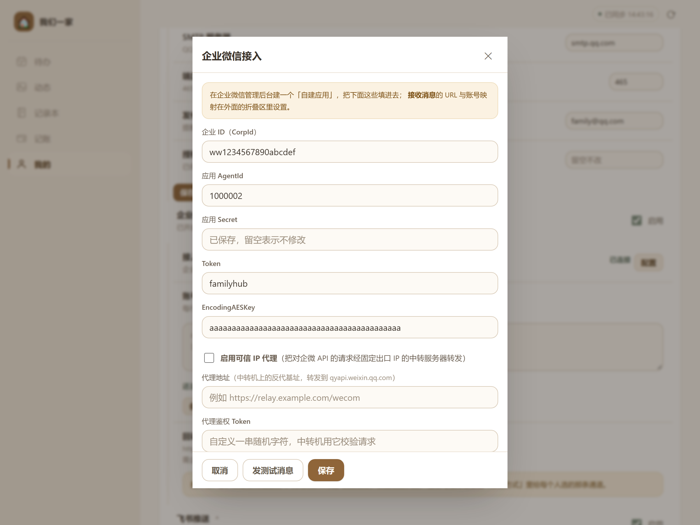

# 教程③ 企业微信消息代理（家宽动态 IP 的解法）

> 耗时约 30 分钟，难度中。
> 一句话：把「我们一家」调企业微信接口的请求，绕到一台**固定公网 IP** 的中转机上，白名单只需要维护一个 IP。

---

## 什么时候需要它

企业微信要求「调用 API 的服务器 IP」在该应用的**企业可信 IP** 白名单里。家里的情况通常是：

| 情况 | 结果 |
| --- | --- |
| 家宽动态 IP，隔几天换一次 | 企业微信报 `60020`，推送全挂 |
| 机器在 NAT 后面 | 换的是整个出口，你控制不了 |
| 双宽带 / 4G 备份切换 | 一切换就报错 |

思路很直接：**找一台 IP 不变的机器替你出面**，企业微信只看到它的 IP。

```
家里 NAS（动态 IP） ──► 中转机（固定 IP，校验令牌后透明转发） ──► qyapi.weixin.qq.com
```

> ⚠️ 它只解决**往外发**。企微回调你（家人发消息）是反方向，不走代理，仍需公网可达。
> 代理解决「推送发不出去」，不解决「收不到消息」。

---

## 前置准备

| 准备项 | 要求 | 说明 |
| --- | --- | --- |
| 一台固定公网 IP 的服务器 | 任意云厂商最低配（1 核 1G 够） | 只做转发，不存数据 |
| 域名 + HTTPS | 强烈建议 | 请求 URL 里带 Secret，不要走明文 |
| Node.js ≥ 18 或 Nginx | 二选一即可 | 推荐 Node 方案，零依赖 |
| 已配好的企业微信自建应用 | 见 [教程②](02-企业微信推送配置.md) | 需要 CorpId / AgentId / Secret |

> 不能用家里的机器当中转——**IP 不变**才是这个方案的全部价值。

---

## 第 1 步：部署中转程序

完整代码在仓库里：[`docs/tutorials/tools/wecom-relay.js`](tools/wecom-relay.js)（约 130 行，只用 Node 内置模块，不用 `npm install`）。

它的契约很简单：把 `<代理地址> + 原路径` 转发到 `https://qyapi.weixin.qq.com + 原路径`，原样带回响应，并校验请求头 `X-FH-Proxy-Token`。

```bash
# 1) 传文件并建一个专用账号
sudo mkdir -p /opt/wecom-relay
sudo cp wecom-relay.js /opt/wecom-relay/
sudo useradd -r -s /usr/sbin/nologin relay 2>/dev/null || true

# 2) 生成一个长随机令牌（下面要用两次：一次给 systemd，一次填进应用）
openssl rand -hex 32

# 3) 写 systemd 单元（把令牌粘进去）
sudo tee /etc/systemd/system/wecom-relay.service > /dev/null <<'EOF'
[Unit]
Description=WeCom API relay for family-hub
After=network-online.target

[Service]
Type=simple
User=relay
Environment=PORT=8080
Environment=HOST=127.0.0.1
Environment=PREFIX=/wecom
Environment=PROXY_TOKEN=把上面生成的令牌粘到这里
ExecStart=/usr/bin/node /opt/wecom-relay/wecom-relay.js
Restart=always
NoNewPrivileges=true

[Install]
WantedBy=multi-user.target
EOF

# 4) 启动并自检
sudo systemctl daemon-reload
sudo systemctl enable --now wecom-relay
curl -s http://127.0.0.1:8080/healthz    # 期望输出 ok
```

> 没装 Node？`apt install nodejs`（版本 ≥ 18 即可）。

三件代码里已经做好的事，别改掉：只放行 `/cgi-bin/*`（否则是开放代理）、令牌用常量时间比较、不在日志里打印带 `corpsecret` 的 URL。

---

## 第 2 步：前面挂 Nginx 上 HTTPS

```nginx
server {
    listen 443 ssl http2;
    server_name relay.example.com;

    ssl_certificate     /etc/letsencrypt/live/relay.example.com/fullchain.pem;
    ssl_certificate_key /etc/letsencrypt/live/relay.example.com/privkey.pem;

    location /wecom/ {
        proxy_pass http://127.0.0.1:8080;
        proxy_http_version 1.1;
        proxy_set_header Host $host;
        proxy_read_timeout 30s;
        client_max_body_size 2m;
    }

    location / { return 404; }
}
```

有了 Nginx 终止 TLS，程序只要 `HOST=127.0.0.1`，8080 不对公网开放。

**不想装 Node？** 用纯 Nginx 反代也行（`location /wecom/` 里 `proxy_pass https://qyapi.weixin.qq.com/;`，再用 `if ($http_x_fh_proxy_token != "令牌") { return 401; }` 校验）。注意两点：该 location 要加 `access_log off;`（否则日志里会留下 `corpsecret`），且 Nginx 启动时才解析上游 DNS，换 IP 后要 `nginx -s reload`。

---

## 第 3 步：在本应用启用

路径：**我的 → 推送渠道设置 → 企业微信推送 → 配置**。



*📷 图 1：弹窗下半部分就是代理三件套：启用勾选框、代理地址、代理鉴权 Token。图源：本机 v5.0.0 实拍（值为演示占位）。*

| 字段 | 填什么 | 注意 |
| --- | --- | --- |
| 启用可信 IP 代理 | 打勾 | 不打勾时三件套全部忽略，直连 qyapi |
| 代理地址 | `https://relay.example.com/wecom` | 必须 `http(s)://` 开头，结尾不要带斜杠 |
| 代理鉴权 Token | 第 1 步的 `PROXY_TOKEN` | 只写不读，留空表示不修改 |

保存后点「发测试消息」。不用重启应用，下一次请求就生效。

---

## 第 4 步：验证（在中转机上执行）

```bash
# 健康检查 → ok
curl -s http://127.0.0.1:8080/healthz

# 不带令牌 → 401
curl -s -o /dev/null -w '%{http_code}\n' \
  'http://127.0.0.1:8080/wecom/cgi-bin/gettoken?corpid=demo&corpsecret=demo'

# 带令牌打一个假企业 → 返回企微自己的 40013，说明链路通了
curl -s -H 'X-FH-Proxy-Token: 你的令牌' \
  'http://127.0.0.1:8080/wecom/cgi-bin/gettoken?corpid=wwdemo&corpsecret=demo'
```

第三条返回里的 **`from ip`** 就是企业微信看到的出口 IP ——**把它填进「企业可信 IP」白名单**。这顺带解决了「白名单该填什么」这个最常见的问题。

---

## 排查

| 现象 | 原因 | 怎么办 |
| --- | --- | --- |
| `proxy token mismatch` / 401 | 两边令牌不一致（多了空格、少了几位） | 逐字核对，改完两边都更新 |
| `404 path not found` | 代理地址结尾与 `PREFIX` 不匹配 | 地址改成 `https://域名/wecom` |
| `only /cgi-bin/* is allowed` | Nginx 的 location 前缀与 `proxy_pass` 斜杠不成对 | 检查结尾斜杠 |
| `upstream unreachable` / 502 | 中转机出不了网或 DNS 解析失败 | 在中转机上 `curl -I https://qyapi.weixin.qq.com` |
| 代理通了，企微仍报 `60020` | 白名单填的是家里 IP，不是中转机 IP | 用第 4 步的 `from ip` 去填 |
| 启用代理后收不到消息了 | 误以为代理也代理回调 | 回调不走代理，查回调 URL 公网可达性 |
| 过一阵突然 502 | Nginx 缓存了旧的上游 IP | `nginx -s reload`，或改用变量 + `resolver` |

---

## 安全提醒

1. **一定要设 `PROXY_TOKEN`**，否则就是一个开放代理。
2. **一定要 HTTPS**，URL 里带 `corpsecret`。
3. **只放行 `/cgi-bin/`**，不要为了让某个接口能通就放开路径。
4. **中转机只干转发**，别在上面跑别的服务。
5. 换令牌后：`systemctl restart wecom-relay` + 应用里更新「代理鉴权 Token」。

---

## 验收清单

- [ ] 云服务器固定 IP、域名已解析、证书已配
- [ ] 服务已启动，`/healthz` 返回 ok
- [ ] 无令牌 401、非 `/cgi-bin/` 路径 403
- [ ] 带令牌能拿到企微返回（看到 `from ip`）
- [ ] 该 IP 已填进「企业可信 IP」
- [ ] 应用里勾选代理、填好地址与令牌，「发测试消息」能收到
- [ ] 家里 IP 变化后推送仍正常
