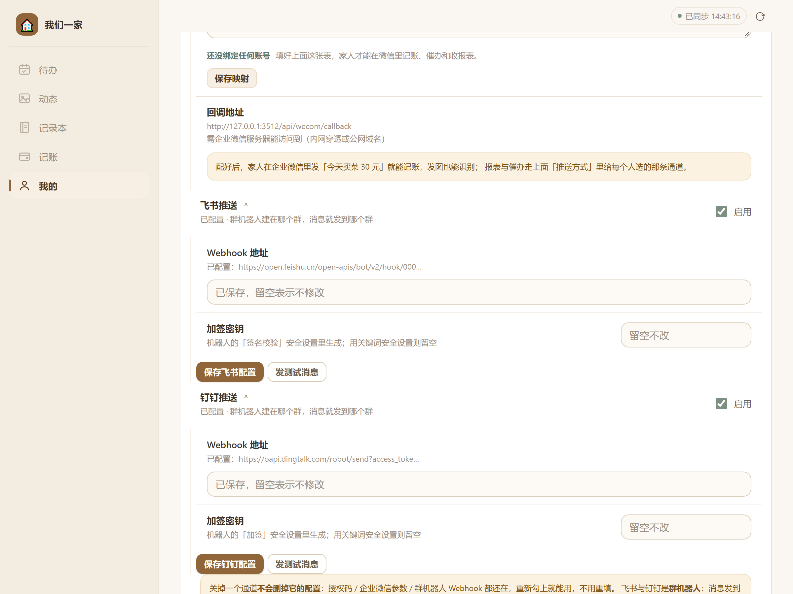
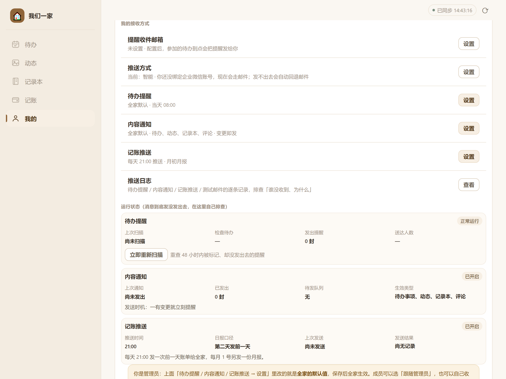

# 教程④ 钉钉与飞书推送配置

> 耗时约 15 分钟（两个都配），难度低。
> 一句话：在钉钉群 / 飞书群里加一个「自定义机器人」，把 Webhook 地址填进本应用，这个群就能收到提醒和报表。

和邮件、企业微信的区别：

| | 邮件 / 企业微信 | 钉钉 / 飞书 |
| --- | --- | --- |
| 投递到 | 某个人 | 一个群（全群可见） |
| 要绑定个人吗 | 要 | 不要，配一次全家共用 |
| 谁配 | 管理员配发件人 + 每人配收件人 | 只有管理员 |
| 失败会回落吗 | 智能通道会回落邮件 | **不会**，直接失败（只记日志） |

所以：**群机器人配完一定要点「发测试消息」**，没有兜底。

---

## 前置准备

| 准备项 | 钉钉 | 飞书 |
| --- | --- | --- |
| 一个群 | 需要（建议拉上家人） | 同左 |
| 群管理权限 | 添加机器人通常要群主 | 同左 |
| 服务器出网 | `oapi.dingtalk.com:443` | `open.feishu.cn:443` |
| 不需要 | 公网回调、企业认证、IP 白名单 | 同左 |

两者门槛都比企业微信低：**不要公网地址，也不要 IP 白名单**。

---

## 第 1 步：钉钉加机器人

官方文档：<https://open.dingtalk.com/document/orgapp/custom-robot-access>

1. 打开要收消息的**群聊** → 右上角 **群设置（齿轮）→ 机器人 → 添加机器人**。
2. 选 **自定义**（有的版本叫「自定义机器人（通过 Webhook 接入）」）→ 添加。
3. 填名称（如 `我们一家`），**安全设置选「加签」**（推荐）。
4. 完成后复制 **Webhook 地址**（`https://oapi.dingtalk.com/robot/send?access_token=…`）和以 `SEC` 开头的**密钥**。

安全设置怎么选：

| 方式 | 本应用怎么填 | 说明 |
| --- | --- | --- |
| 加签（推荐） | Webhook + `SEC…` 密钥 | 不受消息内容影响 |
| 自定义关键词 | 只填 Webhook，密钥留空 | 关键词必须出现在消息里，建议填「提醒」 |
| IP 地址段 | 不适用 | 家宽 IP 不固定，填了必失败 |

---

## 第 2 步：飞书加机器人

官方文档：<https://open.feishu.cn/document/client-docs/bot-v3/add-custom-bot>

1. 群聊 → **群设置 → 群机器人 → 添加机器人**。
2. 选 **自定义机器人** → 添加，填名称。
3. 安全设置选 **签名校验**（推荐），或关键词。
4. 复制 **Webhook 地址**（`https://open.feishu.cn/open-apis/bot/v2/hook/…`）与密钥（8–64 位字母数字）。

---

## 第 3 步：在本应用填写

路径：**我的 → 推送渠道设置 → 飞书推送 / 钉钉推送**。

*📷 图 1：飞书与钉钉两块结构相同：启用勾选、Webhook、加签密钥，底部「保存」与「发测试消息」。图源：本机 v5.0.0 实拍。*

| 字段 | 填什么 | 提示 |
| --- | --- | --- |
| 启用 | 打勾 | 关掉只是不发，配置不丢 |
| Webhook 地址 | 上一步复制的 | 保存后显示打码地址；再改时留空 = 不修改 |
| 加签密钥 | 用了加签就填；用关键词留空 | 保存后不回显 |

保存后点 **发测试消息**：群里应立刻出现一条消息；失败会带平台返回的原始报文。

---

## 第 4 步：让家人选这个通道

群机器人是**群级**的，用不用它由**每个人**自己选。

路径：**我的 → 消息推送设置 → 推送方式 → 设置**。

*📷 图 2：「推送方式」默认「智能」，点右侧「设置」可切到仅邮件 / 仅企业微信 / 邮件+企业微信 / 飞书群 / 钉钉群。图源：本机 v5.0.0 实拍。*

| 选项 | 行为 | 失败时 |
| --- | --- | --- |
| 智能（默认） | 绑了企微走企微，没绑走邮件 | 回落邮件 |
| 仅邮件 / 仅企业微信 | 单一通道 | 不回退 |
| 邮件 + 企业微信 | 两条都发 | 各自独立 |
| 飞书群 / 钉钉群 | 只发到群 | 不回退 |

> 选了群通道，消息全群可见。想让某类提醒只自己看，选「仅邮件」或「仅企业微信」。

---

## 排查

| 现象 | 原因 | 怎么办 |
| --- | --- | --- |
| 钉钉 `310000 sign not match` | 密钥不对，或服务器时间偏差超 1 小时 | 核对密钥；服务器上 `date` 校时 |
| 钉钉 `keywords not in content` | 选了关键词但消息里没有 | 换「加签」，或关键词改成「提醒」 |
| 钉钉 `300001 token is not exist` | Webhook 复制不全 / 机器人被删 | 重新复制完整地址 |
| 飞书 `19024` | 密钥错或时间不准 | 核对密钥，校准 NTP |
| 飞书 `19021 ip not in whitelist` | 安全设置选了 IP 白名单 | 改成签名校验 |
| 保存时提示 Webhook 格式不对 | 少了 `https://` 或不是官方域名 | 用群里复制的原地址 |
| 保存时提示密钥应以 `SEC` 开头 | 复制少了前缀 | 重新复制 |
| 测试消息能收到，正常提醒收不到 | 那人没把推送方式改成群通道 | 让他去「推送方式」改 |
| 只有一个人收到 | 其他人推送方式不是群通道，或总开关被关 | 逐个核对 |

排查顺序：总开关 → Webhook 是否「已配置」→ 发测试消息看返回 → 那人的推送方式 → 推送日志。

---

## 验收清单

- [ ] 钉钉群机器人已添加，Webhook（和 `SEC…` 密钥）已复制
- [ ] 飞书群机器人已添加，Webhook 与密钥已复制
- [ ] 两块都已启用，Webhook 显示「已配置」
- [ ] 两个「发测试消息」都成功，群里都看到了
- [ ] 需要收群的家人已把推送方式改成「钉钉群」/「飞书群」
- [ ] 造一条 5 分钟后的待办，到点群里收到
