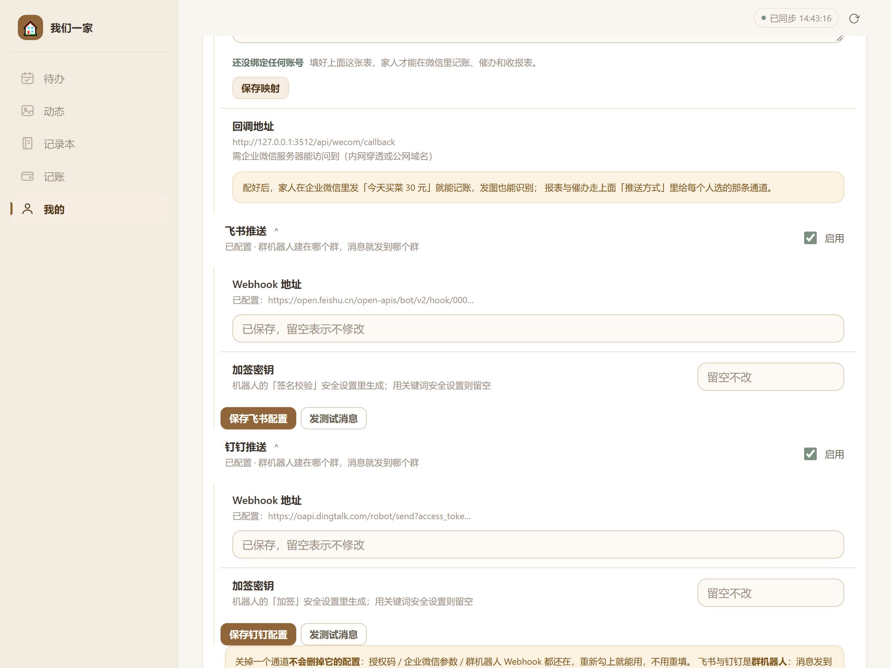
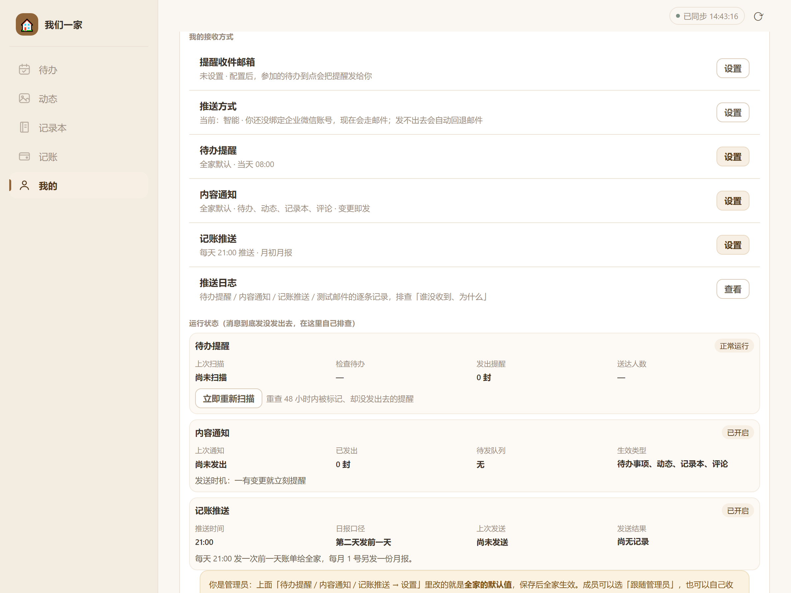

# 教程④ 钉钉与飞书推送配置

> 适用版本：**v4.27.0**　｜　预计耗时：15 分钟（两个都配）　｜　难度：简单
> 一句话：在钉钉群 / 飞书群里加一个「自定义机器人」，把 Webhook 地址填进「我们一家」，这个群就能收到待办提醒、内容通知和记账报表。

---

## 一、先理解它和邮件、企业微信的区别

这条通道的形态和另外两条**根本不同**，理解这一点能省掉一半的疑问：

| | 邮件 / 企业微信 | 钉钉 / 飞书 |
|---|---|---|
| 投递目标 | **某个人** | **一个群**（群里所有人可见） |
| 需要绑定个人吗 | 需要（每人填邮箱 / 映射 UserID） | **不需要**，配一次全家共用 |
| 谁配 | 管理员配发件人 + 每人配收件人 | **只有管理员配一次** |
| 发送失败会怎样 | `智能` 通道会回落邮件 | **不会回落**，直接失败（只记日志） |

最后一行很重要：**群机器人配错了，不会有任何兜底**。所以配完一定要点「发测试消息」。

```
                    ┌── 邮件 ──► 某人的邮箱
待办到点 ──► push ──┼── 企业微信 ──► 某人的微信
                    ├── 钉钉群 ──► 一个钉钉群里所有人
                    └── 飞书群 ──► 一个飞书群里所有人
```

**多人选同一个群通道时只发一条**（按通道去重），不会因为三个人都选「钉钉群」就刷三条。

---

## 二、关于本文截图

| 截图类型 | 来源 | 说明 |
|---|---|---|
| **本项目界面图**（图 1、图 2） | 在本机运行 v4.27.0 真实服务、用 Chrome 实际点击界面截取 | Webhook 里的 `0000demo`、`access_token=demo` 是**演示占位值** |
| **钉钉 / 飞书群设置界面** | **不提供截图** | 两家客户端改版频繁（尤其手机端和桌面端不一致），贴图容易误导。本文给「入口路径 + 按钮名 + 该复制什么」的文字说明，请以你实际界面为准 |

---

## 三、前置准备

| 准备项 | 钉钉 | 飞书 |
|---|---|---|
| **一个群** | 需要（可以只有你自己，但建议拉上家人） | 同左 |
| **群管理权限** | 添加机器人通常需要群主/管理员 | 同左 |
| **服务器出网** | 能访问 `oapi.dingtalk.com:443` | 能访问 `open.feishu.cn:443` |
| **不需要** | 公网回调、企业认证、可信 IP | 同左 |

> 两者的门槛都比企业微信低得多：**不需要公网地址，也不需要 IP 白名单**。这是群机器人最大的优点。

---

## 四、钉钉：添加自定义机器人

> 官方文档：<https://open.dingtalk.com/document/orgapp/custom-robot-access>

1. 打开钉钉，进入你要接收消息的**群聊**。
2. 点右上角 **「群设置」**（齿轮图标）→ **「机器人」** → **「添加机器人」**。
3. 在机器人列表里选 **「自定义」**（有的版本叫「自定义机器人（通过 Webhook 接入）」）→ **「添加」**。
4. 填写：
   - **机器人名称**：例如 `我们一家`。这个名字会显示在每条消息的发送者位置。
   - **安全设置**：三选一，见下面的对照表。**推荐「加签」**。
5. 勾选同意协议 → **「完成」**。
6. 页面会给出一个 **Webhook 地址**，形如：

```
https://oapi.dingtalk.com/robot/send?access_token=一长串字符
```

7. **复制这个地址**。（如果选了「加签」，页面上还有一串以 `SEC` 开头的**密钥**，也一起复制。）

### 安全设置怎么选

| 方式 | 在本项目里怎么填 | 适合谁 |
|---|---|---|
| **加签**（推荐） | Webhook 地址 + 把 `SEC…` 密钥填进「加签密钥」 | 所有人。安全性最好，且不受消息内容影响 |
| **自定义关键词** | 只填 Webhook 地址，**「加签密钥」留空** | 图省事的人。但关键词必须真的出现在消息里，否则发送失败 |
| **IP 地址段** | **不适用** | 本项目从你的家里服务器发出，家宽 IP 不固定，填了必然失败 |

> 选「自定义关键词」时，关键词要覆盖消息里会出现的词。本项目的提醒消息里通常含「提醒」「待办」「记账」等词——**建议直接填「提醒」**，兼容性最好。填错关键词的典型报错是 `keywords not in content`。

---

## 五、飞书：添加自定义机器人

> 官方文档：<https://open.feishu.cn/document/client-docs/bot-v3/add-custom-bot>

1. 打开飞书，进入目标**群聊**。
2. 点右上角 **「群设置」** → **「群机器人」** → **「添加机器人」**。
3. 选择 **「自定义机器人」** → **「添加」**。
4. 填写：
   - **名称**：例如 `我们一家`。
   - **描述**：可留空。
5. 进入「安全设置」，同样三选一：

| 方式 | 在本项目里怎么填 |
|---|---|
| **签名校验**（推荐） | Webhook 地址 + 把密钥填进「加签密钥」 |
| **自定义关键词** | 只填 Webhook 地址，密钥留空 |
| **IP 白名单** | **不适用**（原因同上） |

6. 完成后复制 **Webhook 地址**，形如：

```
https://open.feishu.cn/open-apis/bot/v2/hook/一长串字符
```

> 飞书的密钥在「签名校验」里点开才显示，形如 `AbCdEf123456`（8–64 位字母数字）。

---

## 六、在应用里填写

路径：**我的 → 推送渠道设置 → 页面下半部分「飞书推送」/「钉钉推送」**



*📷 图 1：「飞书推送」与「钉钉推送」两块并列，结构完全一样：一行「启用」勾选框、一个 Webhook 输入框、一个加签密钥输入框，底部「保存 XX 配置」+「发测试消息」。图源：本机 v4.27.0 实拍。*

每块填两项：

| 界面字段 | 填什么 | 提示 |
|---|---|---|
| **启用** | 打勾 | 关掉只是不发，配置不会丢 |
| **Webhook 地址** | 上一节复制的地址 | 保存后显示「已配置：https://…/hook/000…」（中间打码）。**再改时留空 = 不修改** |
| **加签密钥** | 用了加签就填 `SEC…` / 飞书的密钥；用关键词就**留空** | 保存后不回显，显示「已保存，留空表示不修改」 |

填完点 **「保存飞书配置」** / **「保存钉钉配置」**，再点 **「发测试消息」**。

- 成功：你的群里立刻出现一条测试消息。
- 失败：页面提示里带平台返回的原始报文，对照第八节的表。

---

## 七、让家人选择这个通道

群机器人是**群**级别的，但「用不用它」是**每个人**自己选的。

路径：**我的 → 消息推送设置 → 推送方式 → 设置**



*📷 图 2：「推送方式」当前显示「智能」。点右侧「设置」可以切换成「仅邮件 / 仅企业微信 / 邮件+企业微信 / 飞书群 / 钉钉群」。图源：本机 v4.27.0 实拍。*

可选值与行为：

| 选项 | 行为 | 失败会怎样 |
|---|---|---|
| **智能**（默认） | 绑了企业微信→走企微；没绑→走邮件 | 企微失败会**回退邮件** |
| **仅邮件** | 只发邮件 | 失败只记日志 |
| **仅企业微信** | 只发企微 | 失败**不回退** |
| **邮件 + 企业微信** | 两条都发 | 各自独立 |
| **飞书群** | 只发到飞书群 | 失败**不回退** |
| **钉钉群** | 只发到钉钉群 | 失败**不回退** |

> 选了群通道的人，消息进的是**群**——全群可见。如果某类提醒只想自己看（比如记账明细），这个人应该选「仅邮件」或「仅企业微信」，而不是群。

---

## 八、关键配置项说明

| 界面字段 | 服务端键 | 校验规则 | 说明 |
|---|---|---|---|
| 飞书推送「启用」 | `push_feishu_enabled` | — | 关掉后选「飞书群」的人收不到 |
| 飞书 Webhook | `feishu_webhook` | **必须以 `https://open.feishu.cn/` 开头** | 填错直接拒绝保存 |
| 飞书加签密钥 | `feishu_secret` | 8–64 位字母或数字 | 用关键词安全设置时留空 |
| 钉钉推送「启用」 | `push_dingtalk_enabled` | — | 同上 |
| 钉钉 Webhook | `dingtalk_webhook` | **必须以 `https://oapi.dingtalk.com/` 开头** | 填错直接拒绝保存 |
| 钉钉加签密钥 | `dingtalk_secret` | `SEC` 开头 + 6–97 位字母数字（或纯字母数字 8–100 位） | 用关键词安全设置时留空 |

**签名是怎么算的**（知道这个，排查 `sign not match` 就有方向）：

| 平台 | 待签字符串 | HMAC 密钥 | 结果放在哪 |
|---|---|---|---|
| **钉钉** | `` `${毫秒时间戳}\n${secret}` `` | **就是 secret 本身** | URL 上追加 `&timestamp=…&sign=…`，sign 需 URL 编码 |
| **飞书** | `` `${秒级时间戳}\n${secret}` `` | **空字符串**（这是官方的特殊设计） | 请求体里的 `sign` 与 `timestamp` 字段 |

两者「待签字符串」格式一样，但**密钥一个用 secret、一个用空串**，且时间戳一个毫秒一个秒——自己写脚本时最容易在这里踩坑。本项目已按各自官方口径实现。

---

## 九、常见问题排查

| 现象 / 平台返回 | 原因 | 怎么办 |
|---|---|---|
| 钉钉返回 `{"errcode":310000,"errmsg":"sign not match"}` | 加签密钥不对，或服务器时间偏差超过 1 小时 | 核对密钥；在服务器上 `date` 看时间是否准（群机器人签名对时间敏感） |
| 钉钉返回 `keywords not in content` | 安全设置选了「自定义关键词」，但关键词没出现在消息里 | 换成「加签」，或把关键词改成「提醒」这种一定出现的词 |
| 钉钉返回 `token is not exist`（300001） | Webhook 里的 `access_token` 被复制漏了 / 机器人被删了 | 回群里重新复制完整地址 |
| 飞书返回 `{"code":19024,"msg":"sign match fail or timestamp is not within one hour…"}` | 密钥错，或服务器时间不准 | 核对密钥；校准时间（`timedatectl` / `ntpdate`） |
| 飞书返回 `19021 ip not in whitelist` | 安全设置选了「IP 白名单」 | 改成「签名校验」或「关键词」——家里 IP 不固定，白名单不适合 |
| 保存时提示 **Webhook 应是 https://oapi.dingtalk.com/… 开头** | 地址填成了新版/其它域名，或少了 `https://` | 只接受 `https://oapi.dingtalk.com/` 与 `https://open.feishu.cn/` 两个域；用群里复制的原地址 |
| 保存时提示 **加签密钥应以 SEC 开头** | 密钥复制少了前缀 | 钉钉密钥一定以 `SEC` 开头，重新复制 |
| 保存时提示 **飞书加签密钥应是 8-64 位字母或数字** | 密钥里有 `-` `_` 等符号，或长度不对 | 重新复制；确认没带空格 |
| 测试消息能收到，但正常提醒收不到 | 那个人还没把「推送方式」改成「钉钉群/飞书群」 | 让他去「消息推送设置 → 推送方式」改 |
| 只有一个人收到了，其他人没收到 | 其他人的推送方式不是群通道；或他们选了群但通道开关被关了 | 逐个核对「推送方式」与总开关 |
| 群解散 / 机器人被移除 | Webhook 失效 | 重新建机器人，更新 Webhook |
| 想换群 | 直接改 Webhook 地址即可 | 旧地址被覆盖，不需要先清空 |

**排查固定顺序**：`总开关是否勾选` → `Webhook 是否显示「已配置」` → `点「发测试消息」看平台返回` → `看那个人的「推送方式」` → `看「推送日志」`。

---

## 十、钉钉 vs 飞书：选哪个

| | 钉钉 | 飞书 |
|---|---|---|
| 家用普及度 | 一般（多为公司用） | 一般 |
| 机器人添加难度 | 低 | 低 |
| 安全设置 | 加签 / 关键词 / IP 段 | 签名校验 / 关键词 / IP 白名单 |
| 移动端消息体验 | 好 | 好 |
| 本项目支持 | ✅ | ✅ |

**如果家里没人用这两个，建议直接用邮件（教程①）+ 企业微信（教程②）**：邮件门槛最低，企业微信能实现「在微信里发一句话就记账」。群机器人更适合「有个家庭群，想让提醒进群」的场景。

两个都配也没问题——它们是**互相独立**的通道，同一个人只能选其中一个（推送方式单选），但不同家人可以各选各的。

---

## 十一、验收清单

- [ ] 钉钉群已添加自定义机器人，复制了 Webhook（用了加签的还复制了 `SEC…` 密钥）
- [ ] 飞书群已添加自定义机器人，复制了 Webhook（用了签名校验的还复制了密钥）
- [ ] 「推送渠道设置」里两块都已勾选「启用」、Webhook 显示「已配置」
- [ ] 两个「发测试消息」都成功，群里都看到了消息
- [ ] 需要收群的家人已把「推送方式」改成「钉钉群」/「飞书群」
- [ ] 造一条 5 分钟后的待办，到点群里收到提醒
- [ ] 「推送日志」里能看到该条记录的通道与结果

---

## 附：本文依据

- 群机器人配置与状态文案：`family-hub/public/app.js` 的 `hookBox()`（飞书/钉钉同构渲染）与「推送方式」选项（`飞书群` / `钉钉群`）
- Webhook / 密钥校验规则：`family-hub/src/feishu.js` 与 `family-hub/src/dingtalk.js` 的 `saveConfig()`
- 签名算法：`family-hub/src/dingtalk.js` 的 `sign()`（HMAC-SHA256，密钥=secret，毫秒时间戳，拼在 URL）与 `family-hub/src/feishu.js` 的 `sign()`（HMAC-SHA256，**空密钥**，秒级时间戳，放 body）
- 通道回落规则：`family-hub/src/push.js`（`auto` 会回退邮件；`wecom` / `feishu` / `dingtalk` 不回退）
- 钉钉官方：<https://open.dingtalk.com/document/orgapp/custom-robot-access>　飞书官方：<https://open.feishu.cn/document/client-docs/bot-v3/add-custom-bot>
