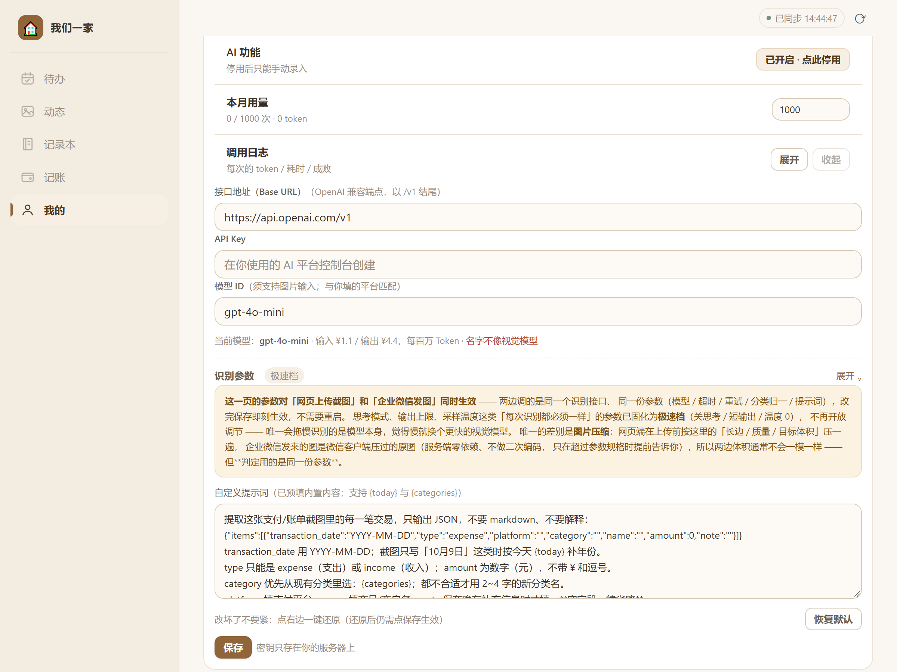
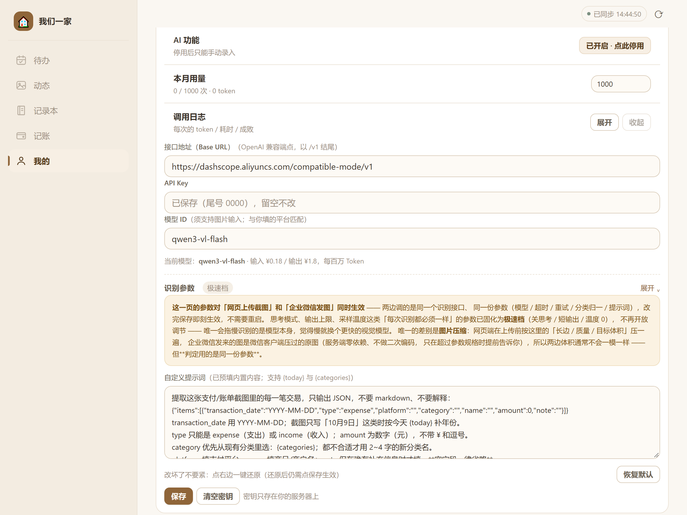

# 教程⑤ AI 接入（以通义千问 / 阿里云百炼为例）

> 耗时约 15 分钟，难度低。
> 一句话：填三项 —— 接口地址、API Key、模型 ID —— 记账里的「拍小票自动识别」就能用。

识别由你选的 AI 平台完成，本项目只负责把图片发过去、把结果写进数据库。**用你自己的 Key，费用花在自己账号上**，没有内置密钥，也不经过任何中间服务器。

两个入口共用同一套配置：网页「记账 → 上传截图」，和企业微信里给应用发一张小票照片（需先配好 [教程②](02-企业微信推送配置.md)）。

---

## 前置准备

1. **阿里云账号**并完成**实名认证**。
2. **开通「大模型服务平台百炼」**：<https://bailian.console.aliyun.com/>（开通免费，按调用量计费）。
3. **服务器能出网**：能访问 `dashscope.aliyuncs.com:443`。
4. **管理员账号**：「AI 参数设置」只对管理员可见。

> 想用别家也行：任何提供 **OpenAI 兼容** `/chat/completions` 端点、且模型支持图片输入的平台都能填（DeepSeek、智谱、Gemini 兼容端点等）。

---

## 第 1 步：创建 API Key

官方文档：<https://help.aliyun.com/zh/model-studio/get-api-key>

1. 登录 <https://bailian.console.aliyun.com/>。
2. 进 **API-KEY 管理** → **创建我的 API-KEY**。
3. 归属账号选**主账号**，业务空间选**默认业务空间**。
4. 复制 `sk-` 开头的 Key —— **只完整显示一次**。

⚠️ Key 等于钱包：不要发群里、不要提交到 Git。

---

## 第 2 步：在应用里填三项

路径：**我的 → AI 参数设置**。

第一次进来看到的是出厂默认，指向 OpenAI，国内网络下必须改地址：

*📷 图 1：未配置时的样子：接口地址 `https://api.openai.com/v1`、模型 `gpt-4o-mini`，都是出厂默认。图源：本机 v5.0.0 实拍。*

改成千问之后：

*📷 图 2：填好千问后的样子，下方「当前模型」会显示内置价格提示。图源：本机 v5.0.0 实拍。*

| 字段 | 千问填法 | 说明 |
| --- | --- | --- |
| 接口地址 | `https://dashscope.aliyuncs.com/compatible-mode/v1` | 必须以 `/v1` 结尾，不要带 `/chat/completions` |
| API Key | 第 1 步的 `sk-…` | 保存后只显示「已保存（尾号 xxxx）」 |
| 模型 ID | `qwen3-vl-flash` | 必须是**支持图片输入**的视觉模型 |

点 **保存**。若「当前模型」一行提示「名字不像视觉模型」（比如填了 `qwen-plus`），说明读不了图，换带 `-vl-` 的模型。

模型怎么选：

| 模型 | 定位 | 建议 |
| --- | --- | --- |
| `qwen3-vl-flash` | 快、便宜 | **首选**，小票识别够用 |
| `qwen3-vl-plus` | 更准、更贵 | 字迹模糊、版式怪异、flash 老抽错时换 |

成本量级：一次识别约 0.0005–0.001 元（flash 档），默认月度上限 1000 次，一个月几毛钱。以账单为准。

---

## 第 3 步：验证

1. 进 **记账** → 上传一张真实账单截图（微信/支付宝账单、超市小票都行）。
2. 等几秒弹出识别结果，确认后写入账单。
3. 失败时看两处：页面上方的一句话提示，和 **AI 参数设置 → 调用日志**（有 token 数、耗时与原始错误）。

---

## 第 4 步（可选）：调参数

展开「识别参数」（默认标着「极速档」），对网页上传和企业微信发图同时生效：

| 参数 | 默认 | 什么时候改 |
| --- | --- | --- |
| 超时 | 60 秒 | 网络差、模型慢就调大（最大 300） |
| 失败重试 | 1 | 抖动多可调到 2–3 |
| 模型不可用时自动换默认模型 | 开 | 建议保持开 |
| 新分类的处理 | 自动新建 | 想账目干净就选「只用现有（归其他）」 |
| 图片长边 / 质量 / 体积 | 1024 / 0.7 / 480KB | 小票字太小可把长边调到 1280–1600 |
| 自定义提示词 | 内置模板 | 支持 `{today}` 与 `{categories}`，「恢复默认」可还原 |

> 已下线的四个参数（思考模式 / 思考预算 / 最大输出 / 采样温度）不用找：它们只有唯一正确答案，v4.25.0 起已固化为「极速档」。**觉得慢就换更快的模型**。

---

## 排查

| 现象 | 原因 | 怎么办 |
| --- | --- | --- |
| `401 Unauthorized` / API Key 无效 | Key 复制不全、已删除或不是这家的 | 重新复制，确认没空格 |
| `model not found` / 404 | 模型 ID 拼错或该地域不可用 | 检查 `qwen3-vl-flash`，确认华北2（北京） |
| `does not support image` / 400 | 填了纯文本模型 | 换成带 `-vl-` 的 |
| 一直超时 | 地址还是出厂默认 OpenAI，或图片太大 | 改对地址；调小长边；调大超时 |
| 额度用完 / `quota` | 本月到上限（默认 1000） | 调大月度上限或等下月 |
| `Arrearage` 余额不足 | 阿里云欠费 | 充值 |
| 分类总是「其他」 | 「新分类的处理」选了「只用现有」 | 改成自动新建，或先建好分类 |
| 金额识别错 | 图太糊或模型档位不够 | 长边调到 1600，或换 `qwen3-vl-plus` |
| 识别很慢（20–30 秒） | 用的是推理型模型 | 换 `qwen3-vl-flash` |
| 企业微信发图没反应 | 企微回调没配好（与 AI 无关） | 先按教程②验证收消息方向 |

---

## 换平台：同样三步

| 平台 | 接口地址 | 模型举例 |
| --- | --- | --- |
| 阿里云百炼 | `https://dashscope.aliyuncs.com/compatible-mode/v1` | `qwen3-vl-flash` |
| OpenAI | `https://api.openai.com/v1` | `gpt-4o-mini` |
| 智谱 | `https://open.bigmodel.cn/api/paas/v4` | `glm-4v-flash` |
| Gemini（兼容端点） | `https://generativelanguage.googleapis.com/v1beta/openai` | `gemini-2.5-flash` |

判断标准只有一条：**OpenAI 兼容端点 + 支持图片输入**。

---

## 验收清单

- [ ] 百炼已开通，API Key 已保存
- [ ] 接口地址是百炼兼容端点（不是出厂默认的 OpenAI）
- [ ] 模型 ID 是视觉模型，页面显示「已保存（尾号 xxxx）」
- [ ] 传一张真实小票能识别出金额与日期
- [ ] 调用日志里能看到这次成功记录
- [ ] 本月用量没有异常增长
