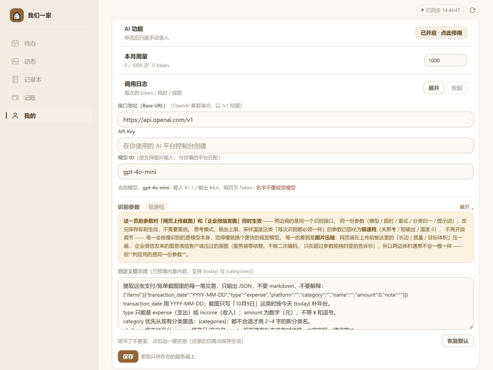
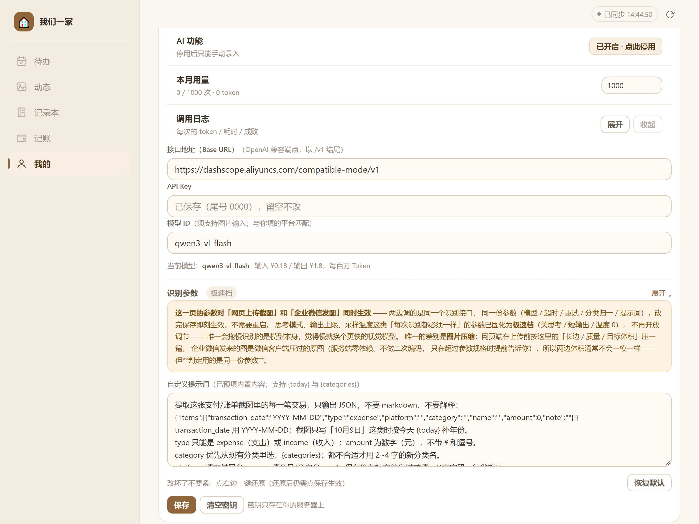

# 教程⑤ AI 接入（以通义千问 / 阿里云百炼为例）

> 适用版本：**v4.27.0**　｜　预计耗时：15 分钟　｜　难度：简单
> 一句话：填三项——接口地址、API Key、模型 ID——「记账」里的**拍小票自动识别**就能用；浏览器上传和企业在微信里发图走的是同一套配置。

---

## 一、这个功能做什么

「我们一家」的记账支持「拍一张小票照片，自动拆成一条条账单」。做识别的是你选的 AI 平台，本项目只负责**把图片发过去、把 JSON 结果写进数据库**。

所以它的本质是：**你提供一个自己的 API Key，费用花在你自己的账号上**。没有内置 Key，也不会经过任何中间服务器。

两个入口、同一套配置：

| 入口 | 怎么用 | 走什么 |
|---|---|---|
| **网页** | 记账 → 上传小票截图 | 浏览器先把图压缩，再发给你的服务器，服务器转给 AI 平台 |
| **企业微信** | 在企微里给应用发一张小票照片 | 企业微信 → 你的服务器 → AI 平台（需要先配好教程②） |

> 图片在浏览器里会先按「长边 / 质量 / 目标体积」压一遍再上传（默认 1024px / 0.7 / 480KB），因为家庭宽带的**上行**往往比模型推理还慢。

---

## 二、关于本文截图

| 截图类型 | 来源 | 说明 |
|---|---|---|
| **本项目界面图**（图 1、图 2） | 在本机运行 v4.27.0 真实服务、用 Chrome 实际点击界面截取 | 图中的 API Key 是演示占位（`尾号 0000`），不是真实密钥 |
| **阿里云百炼控制台** | **不提供截图** | 控制台改版频繁。本文给「入口 + 按钮名 + 该复制什么」的文字说明，并附官方文档，请以你实际界面为准 |

---

## 三、前置准备

1. **一个阿里云账号**（需完成**实名认证**，否则无法开通百炼）。
2. **开通「大模型服务平台百炼」**。控制台：<https://bailian.console.aliyun.com/>
   开通本身通常免费，按实际调用量计费。新账号一般有一定的免费额度，以控制台显示为准。
3. **服务器能出网**：能访问 `dashscope.aliyuncs.com:443`。
4. **管理员账号**：「AI 参数设置」只对管理员可见。

> **用其它平台可以吗？** 可以。本项目从 v4.24.0 起不再绑定任何一家，凡是提供 **OpenAI 兼容** `chat/completions` 端点的平台都能填——DeepSeek、智谱、OpenAI、Google Gemini 的兼容端点等。教程只以千问为例，因为它在国内网络下最省事、且有便宜的快模型。

---

## 四、第 1 步：在百炼控制台创建 API Key

> 官方文档：<https://help.aliyun.com/zh/model-studio/get-api-key>

1. 浏览器打开 <https://bailian.console.aliyun.com/>，用阿里云账号登录（首次需开通服务）。
2. 进入 **「API-KEY 管理」**（左侧或右上角菜单里，页签名称类似「API-KEY」）。
3. 点 **「创建我的 API-KEY」**：
   - **归属账号**：选**阿里云账号（主账号）**即可；家里用不需要 RAM 子账号。
   - **归属业务空间**：选**默认业务空间**（这个空间下的 Key 能调用全部标准模型）。
4. 点确认，页面上会出现一串 `sk-` 开头的 Key。**点旁边的复制图标，立刻保存**——它**只在创建时完整显示一次**。

⚠️ **两点提醒**

- **API Key 相当于钱包**。拿到它就能以你的身份调用并产生费用，不要发到群里、不要提交到 Git。
- **Key 与地域相关**。本文用的是中国大陆（北京）地域的通用端点，下面的地址也只适用这个地域。

---

## 五、第 2 步：在应用里填三项

路径：**我的 → AI 参数设置 → 展开**

**第一次进来看到的是这样**——出厂默认指向 OpenAI，国内网络下必须改掉接口地址：

*📷 图 1：未配置时的样子。接口地址是 `https://api.openai.com/v1`、模型是 `gpt-4o-mini`，都是出厂默认值；「AI 功能」显示「已开启 · 点此停用」，「本月用量 0 / 1000」。图源：本机 v4.27.0 实拍。*

改成千问之后：

*📷 图 2：填好千问后的样子。接口地址是百炼的兼容端点，模型 ID 是 `qwen3-vl-flash`，下方「当前模型」一行会显示内置价格提示，并多出「清空密钥」按钮。图源：本机 v4.27.0 实拍。*

三个字段，逐一对应：

| 界面字段 | 千问的填法 | 说明 |
|---|---|---|
| **接口地址（Base URL）** | `https://dashscope.aliyuncs.com/compatible-mode/v1` | **必须以 `/v1` 结尾**（不带 `/chat/completions`，程序会自己拼） |
| **API Key** | 第 1 步复制的 `sk-…` | 保存后不回显，只显示「已保存（尾号 xxxx）」 |
| **模型 ID** | `qwen3-vl-flash` | 必须**支持图片输入**的视觉模型（下面有对照） |

填完点 **「保存」**。

> **注意「当前模型」那一行**。保存后它会显示模型名与价格。如果出现「名字不像视觉模型」这类警告（例如填了 `qwen-plus`），说明你填的模型大概率不支持读图，识别会失败——换带 `-vl-` 的模型。

### 千问视觉模型怎么选

| 模型 ID | 定位 | 内置价格提示（元 / 每百万 Token） | 建议 |
|---|---|---|---|
| `qwen3-vl-flash` | 快、便宜 | 输入 ¥0.18 / 输出 ¥1.8 | **首选**。小票识别这种「看一眼抽字段」的任务够用 |
| `qwen3-vl-plus` | 更准、更贵 | 输入 ¥1.2 / 输出 ¥12 | 小票字迹模糊、版式怪异、flash 老是抽错时再换 |

> 价格来自本项目的内置价格表（`src/ocr.js` 的 `PRICE_TABLE`），只用于界面提示；**实际计费以阿里云账单为准**。表里没有的模型，界面会如实显示「未收录该模型价格 · 以服务商控制台实时定价为准」——本项目不编价格。

### 成本量级（心里有个数）

按官方示例的 token 消耗（一张图约 2500 输入 token、输出不到 100 token）粗算：

- 一次识别约 **0.0005–0.001 元**（flash 档）
- 默认月度上限 **1000 次** → 一个月大约 **几毛钱**

实际值取决于图片大小与输出长度，**以账单为准**。

---

## 六、第 3 步：验证能不能识别

1. 进入 **「记账」** → 找到「拍小票 / 上传截图」入口（浏览器里是选文件，手机上是拍照）。
2. 传一张真实的账单截图（微信/支付宝的账单详情、超市小票照片都行）。
3. 等几秒，应弹出识别结果，确认后写入账单。

**成功的样子**：金额、日期、商户、分类被填好；分类可能自动新建（取决于「新分类的处理」设置）。

**失败的话**，分两类去看：

| 看哪里 | 能看到什么 |
|---|---|
| 页面上方的提示 | 一句话错误原因（如「API Key 无效」） |
| **AI 参数设置 → 调用日志 → 展开** | 每一次调用的 token 数、耗时、成功/失败与原始错误 |

「调用日志」是排查的核心工具——它记录了**每次失败的真实原因**，比界面提示详细。

---

## 七、第 4 步（可选）：调参数

点「识别参数」标题展开（默认收起，标着「极速档」）。这些参数对**网页上传和企业微信发图同时生效**。

| 参数 | 默认 | 什么时候要改 |
|---|---|---|
| **超时（秒）** | 60 | 网络差、模型慢，老是超时就调大（最大 300） |
| **失败重试** | 1 | 网络抖动多可调到 2–3 |
| **模型不可用时自动换默认模型** | 开 | 保持开。关掉则填错模型直接报错，不会自愈 |
| **新分类的处理** | 自动新建 | 想让账目干净、只用现有分类，选「只用现有（归『其他』）」 |
| **上传前压缩图片** | 开 | 保持开。关掉会让上传变很慢，且**不会**让识别更快 |
| **图片长边 / 质量 / 目标体积** | 1024 / 0.7 / 480KB | 小票很小、字看不清时可把长边调到 1280–1600 |
| **提示词里的分类条数** | 8 | 分类特别多时可调小，提示词更短、响应更快 |
| **自定义提示词** | 已预填内置模板 | 想改抽取口径时改；支持 `{today}` 与 `{categories}` 占位符。「恢复默认」可一键还原 |

**已经下线、不用找的四个参数**：思考模式、思考预算、最大输出、采样温度。它们不存在「各人偏好」，只有唯一正确答案（关思考 / 短输出 / 温度 0），v4.25.0 起已固化为「极速档」常量。**觉得识别慢，正确的做法是换更快的模型，而不是找这些开关。**

---

## 八、关键配置项说明

| 界面字段 | 服务端键 | 出厂默认 | 说明 |
|---|---|---|---|
| AI 功能开关 | `ai_enabled` | 开 | 关掉后只能手动录入 |
| 接口地址 | `ai_base_url` | `https://api.openai.com/v1` | **出厂默认是 OpenAI**，国内需改成百炼地址 |
| API Key | `ai_api_key` | 空 | 只写不读；也支持环境变量 `AI_API_KEY` |
| 模型 ID | `ai_vl_model` | `gpt-4o-mini` | 必须是视觉模型；也支持环境变量 `AI_VL_MODEL` |
| 月度上限 | `ai_monthly_limit` | 1000 | 到 95% 预警，用完停用（防跑飞） |
| 超时 | `ai_timeout_ms` | 60000 | 5–300 秒 |
| 重试 | `ai_retry` | 1 | 0–3 |
| 自动换默认模型 | `ai_fallback` | 开 | 模型不可用时自愈 |
| 分类策略 | `ai_category_mode` | `auto` | `strict` = 只用现有分类 |
| 图片压缩 | `ai_img_compress` | 开 | — |
| 长边 / 质量 / 体积 | `ai_img_edge` / `ai_img_quality` / `ai_img_kb` | 1024 / 0.7 / 480 | — |
| 自定义提示词 | `ai_prompt_custom` | 空（用内置） | 最长 2000 字符 |

三条与实现有关的要点：

1. **出厂默认指向 OpenAI**。所以国内用户第一次进来必须改「接口地址」，否则会连不上（表现为超时或 401）。这是刻意设计：不预设某一家平台。
2. **旧配置会自动兼容**。如果你在旧版本填过千问密钥（`qwen_api_key`），升级后识别**照常可用**，界面会提示「检测到密钥仍保存在旧版『千问』配置里，建议重新填一遍完成迁移」。重新填一次是为了把配置统一到新键上。
3. **百炼专属参数只在百炼端点发送**。程序会判断 Base URL 是否含 `dashscope.aliyuncs.com`，是才追加百炼的扩展参数（如关闭思考），避免给其它平台塞不认识字段导致 400。

---

## 九、常见问题排查

| 现象 / 报错 | 原因 | 怎么办 |
|---|---|---|
| 提示 **API Key 无效 / 401 Unauthorized** | Key 复制不全、已被删除，或填成了别家的 Key | 回百炼控制台重新复制；确认没有空格 |
| 提示 **model not found / 404** | 模型 ID 拼错，或该模型在你的账号/地域不可用 | 检查拼写（`qwen3-vl-flash`）；确认地域是华北2（北京） |
| 提示 **does not support image / 400** | 填了纯文本模型（如 `qwen-plus`） | 换成带 `-vl-` 的视觉模型 |
| 一直 **超时** | Base URL 填错（比如填了 `https://api.openai.com/v1` 但网络到不了）；或图片太大 | 先改对地址；再把「图片长边」调小；「超时」调大 |
| 提示 **quota / 额度已用完** | 本月调用次数到上限（默认 1000） | 在「本月用量」右侧把上限调大，或等下月 |
| 提示 **余额不足 / Arrearage** | 阿里云账户欠费 | 去阿里云充值；百炼按量计费 |
| 识别出来了，但**分类总是「其他」** | 「新分类的处理」选了「只用现有」 | 改成「自动新建」，或先把分类建好 |
| **金额识别错**（比如 30.00 读成 3000） | 图片太小/太糊，或模型档位不够 | 把「图片长边」调到 1600；或换 `qwen3-vl-plus` |
| 识别**很慢**（20–30 秒） | 用了推理型模型 | 换 `qwen3-vl-flash`。思考模式已强制关闭，慢就是模型本身慢 |
| 企业微信发图没反应 | 企微回调没配好（与 AI 无关） | 先按教程②验证「收消息」方向能通 |
| 想彻底停用 AI | — | 「AI 功能」右侧按钮切到「已停用」；或点「清空密钥」 |

---

## 十、换平台：同样的三步

想换成别家，只需要改三项，其余全部不变：

| 平台 | 接口地址（Base URL） | 模型 ID 举例 |
|---|---|---|
| **阿里云百炼（本文）** | `https://dashscope.aliyuncs.com/compatible-mode/v1` | `qwen3-vl-flash` |
| OpenAI | `https://api.openai.com/v1` | `gpt-4o-mini` |
| 智谱 | `https://open.bigmodel.cn/api/paas/v4` | `glm-4v-flash` |
| Google Gemini（兼容端点） | `https://generativelanguage.googleapis.com/v1beta/openai` | `gemini-2.5-flash` |

> 判断标准只有一条：**这个平台是否提供 OpenAI 兼容的 `/chat/completions` 端点，且该模型支持图片输入**。地址末尾带不带 `/v1` 取决于平台，照官方文档填即可（程序会自动补 `/chat/completions`）。

---

## 十一、验收清单

- [ ] 阿里云账号已实名、百炼已开通
- [ ] 已创建 API Key 并妥善保存（只显示一次）
- [ ] 「AI 参数设置」里接口地址填的是**百炼兼容端点**（不是出厂默认的 OpenAI）
- [ ] API Key 已填，页面显示「已保存（尾号 xxxx）」
- [ ] 模型 ID 是视觉模型（`qwen3-vl-flash` 或 `qwen3-vl-plus`）
- [ ] 「当前模型」一行显示的价格与预期一致
- [ ] 传一张真实小票，能识别出金额与日期
- [ ] 「调用日志」里能看到这次成功记录（token 数与耗时）
- [ ] 本月用量没有异常增长

---

## 附：本文依据

- 三项配置与出厂默认：`family-hub/src/ocr.js`（`DEFAULT_BASE_URL`、`LEGACY_DASHSCOPE_BASE`、`DEFAULT_VL_MODEL`、`loadConfig()`）
- 内置价格表：同文件 `PRICE_TABLE`（`qwen3-vl-flash` 输入 0.18 / 输出 1.8；`qwen3-vl-plus` 输入 1.2 / 输出 12，单位元/百万 Token）
- 月度上限与预警：同文件 `MONTHLY_FREE = 1000`、`WARN_AT = 950`
- 单图限制：同文件 `MAX_IMAGE_BYTES`（base64 后 4MB）
- 界面字段与文案：`family-hub/public/app.js` 的 `billAiBodyHtml()`
- 百炼官方：控制台 <https://bailian.console.aliyun.com/>　API Key <https://help.aliyun.com/zh/model-studio/get-api-key>　OpenAI 兼容说明 <https://docs.bailian.console.aliyun.com/zh/model-studio/qwen-vl-compatible-with-openai>
